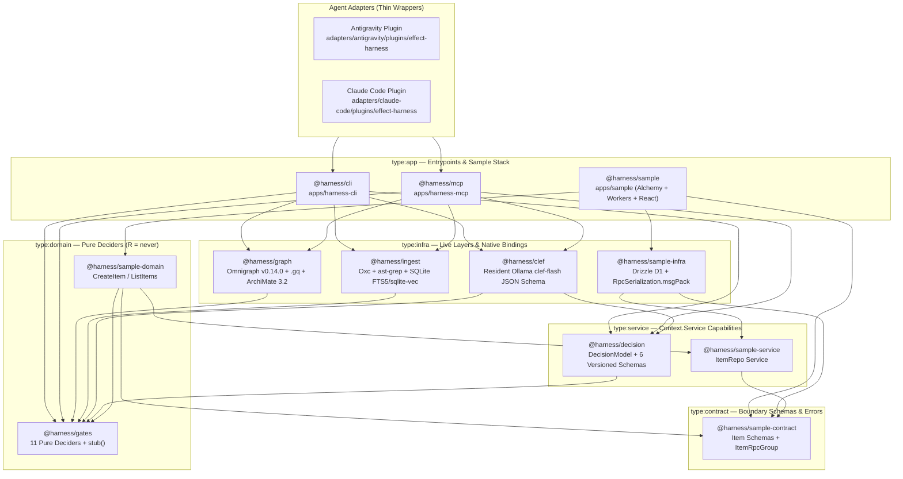
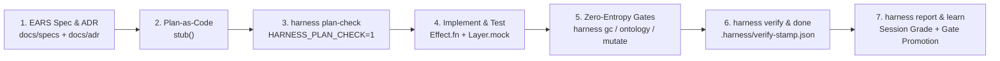

# Effect-TS Engineering Harness

An agentic software engineering harness built in **Effect v4 (`4.0.0-beta.48`)** and **Alchemy v2 (`2.0.0-beta.80`)** on **Cloudflare Workers / D1 / Durable Objects**.

The harness constrains coding agents with deterministic compiler, linter, property-graph, and ontology gates while routing idioms and architectural queries through an embedded structural index and an advisory local language model.

---

## Core Design Principles

1. **Deterministic Gates Always Win:** `@effect/tsgo` (`tsgo` + `@effect/language-service`), `oxlint` (20+ custom AST rules + Nx module boundary rules), Vitest, `GraphGc.decide`, `OntologyInvariants.decide`, and `SpanBudget.decide` hold absolute veto power. The local advisory model (`DecisionModel` / `clef-flash`) never overrides a deterministic check.
2. **Plan-as-Code (`stub<A, E, R>()`):** Before writing implementation bodies, agents translate EARS requirements and ADR decisions into compilable TypeScript skeletons using `stub<A, E, R>(...args)` from `@harness/gates`. `harness plan-check` verifies that `A` (success), `E` (`Schema.TaggedErrorClass` union), and `R` (`Context.Service` capabilities) typecheck across the workspace before implementation begins.
3. **ArchiMate 3.2 + Omnigraph Property Graph:** Requirements, ADRs, domain contracts, services, layers, handlers, and tests are indexed into a single property graph backed by `@modernrelay/omnigraph-core` (`v0.14.0` Rust NAPI + SQLite + `sqlite-vec`) and queried via declarative `.gq` pattern-matching queries.
4. **Zero-Docker, Zero-Python Local Stack:** All parsing, AST extraction, graph traversal, and vector search run in-process on Node.js `>=24.10.0` via Rust NAPI addons (`oxc-parser`, `@ast-grep/napi`, `@modernrelay/omnigraph-core`, `sqlite-vec`).
5. **Compounding Learnings Without Context Bloat:** Verification failures and route misses are recorded in `.harness/friction-log.jsonl` and `.harness/telemetry-log.jsonl`. Instead of appending prose rules to `AGENTS.md`, `harness learn` clusters recurring friction into executable `oxlint` rules, deterministic gate tests, or indexed `agent-patterns/*.md` recipes.

---

## Architecture & Monorepo Topology

The harness is organized as an **Nx (`22.6.1`) + pnpm (`10.27.0`)** monorepo with strict 5-tier architectural boundaries enforced at lint time via `@nx/enforce-module-boundaries`:



### Nx Dependency Taxonomy

| Nx Tag | Allowed Dependencies | Responsibilities | Packages |
| :--- | :--- | :--- | :--- |
| `type:contract` | `type:contract` (`effect` only) | Shared `Schema.Class`, `Schema.TaggedErrorClass`, `HttpApi`, `RpcGroup` | `@harness/sample-contract` (`libs/sample/contract`), `@harness/<scope>-contract` |
| `type:service` | `type:contract`, `type:service` | `Context.Service` capability interfaces (repositories, gateways, model ports) | `@harness/decision` (`libs/harness/decision`), `@harness/sample-service` (`libs/sample/service`) |
| `type:domain` | `type:contract`, `type:service`, `type:domain` | Pure business logic and `R = never` deciders; zero I/O, zero `Layer` construction | `@harness/gates` (`libs/harness/gates`), `@harness/sample-domain` (`libs/sample/domain`) |
| `type:infra` | `type:contract`, `type:service`, `type:domain`, `type:infra` | Live `Layer` implementations, Drizzle D1 repositories, Omnigraph, SQLite, Ollama HTTP | `@harness/clef` (`libs/harness/clef`), `@harness/ingest` (`libs/harness/ingest`), `@harness/graph` (`libs/harness/graph`), `@harness/sample-infra` (`libs/sample/infra`) |
| `type:app` | All tiers | Composition root (`Layer.provideMerge`), CLI/MCP servers, Alchemy `alchemy.run.ts`, web UI | `@harness/cli` (`apps/harness-cli`), `@harness/mcp` (`apps/harness-mcp`), `@harness/sample` (`apps/sample`) |

---

## The 7-Step Gated Task Lifecycle

Every feature or bugfix follows a deterministic 7-step lifecycle:



1. **EARS Specification & ADR (`specifying-ears-with-effect`):**
   Author or update requirements in `docs/specs/<id>.md` using EARS syntax (`WHEN`, `IF/THEN`, `WHILE`, `WHERE`) and architectural decisions in `docs/adr/<id>.md` with YAML frontmatter linking `realizes` / `influences`. Validated by `EarsSpecLint.decide` and `AdrDocLint.decide`.
2. **Plan-as-Code Skeleton (`planning-effect-skeletons`):**
   Map EARS clauses directly to Effect v4 types:
   - `WHEN <trigger>` $\rightarrow$ boundary `Schema.Class` input & success type `A`
   - `IF <condition> THEN <outcome>` $\rightarrow$ `Schema.TaggedErrorClass` in error channel `E`
   - `WHILE <state>` $\rightarrow$ pure `decide(state, input)` function with `R = never` + stateful `Context.Service` in `R`
   - `WHERE <feature>` $\rightarrow$ `Layer` / `Config` dependency in `R`
   Write function signatures returning `stub<A, E, R>(...args)` from `@harness/gates` and add `@harness-Requirement: REQ-...` JSDoc tags.
3. **Plan Gate (`harness plan-check`):**
   Runs `HARNESS_PLAN_CHECK=1 tsgo -b --noEmit` + `oxlint` (allowing `stub()` calls) + `PlanStepCoverageV1`. Checkpoints the verified skeleton onto `plan/<task>`.
4. **Implementation (`executing-effect-stubs`):**
   Replace `stub<A, E, R>()` bodies with production `Effect.fn("Domain.operation")` implementations, live Layers, and Vitest tests using `@effect/vitest` (`it.effect`, `TestClock`, `Layer.mock`). Concurrent subagents isolate work via `Workspace: "share"` or `HARNESS_WORKTREE_ID=<id>`.
5. **Zero-Entropy, Ontology & Mutation Gates (`harness gc`, `harness ontology`, `harness mutate`):**
   - `harness gc --strict`: Checks `GraphGc.decide` for orphan symbols, dead exports, and unreferenced files.
   - `harness ontology --action=check`: Verifies all 5 ArchiMate 3.2 cross-layer traceability invariants (`OntologyInvariants.decide`) and optionally checks semantic drift via `OntologyConflictV1` (`--with-clef`).
   - `harness mutate`: Checks test killer ratios against modified pure domain deciders (`MutationCheck.decide`).
6. **Sanctioned Verification & Completion (`harness verify` $\rightarrow$ `harness done`):**
   - `CI=true harness verify` runs `nx affected -t verify` (`tsgo -b` with `@effect/language-service` strict errors + `oxlint` banning `stub()` and `@effect-diagnostics` suppressions + Vitest), checks `SpanBudget.decide` and `MigrationSafety.decide`, checkpoints `impl/<task>`, and writes `.harness/verify-stamp.json` bound to `git rev-parse HEAD` + working-tree diff hash.
   - `harness done` verifies the stamp matches the current tree before allowing the agent or human to conclude the task.
7. **Observability & Compounding Learnings (`harness report` & `harness learn`):**
   - `harness report` evaluates `.harness/telemetry-log.jsonl` via `SessionReport.decide`, computing a session health score (`0–100`, grade `A–D`) and writing `.harness/session-report.md`.
   - `harness learn` clusters `.harness/friction-log.jsonl` via `Friction.decide` + `LearnProposalV1` to promote recurring mistakes into new `oxlint` rules or `agent-patterns/*.md` recipes.

---

## ArchiMate 3.2 Ontology & Omnigraph `.gq` Engine

`@harness/graph` (`libs/harness/graph`) layers an **ArchiMate 3.2** metamodel on top of `@modernrelay/omnigraph-core` (`v0.14.0`):

| ArchiMate 3.2 Layer | Node Kinds | Source Artifacts | Outgoing Traceability Edges |
| :--- | :--- | :--- | :--- |
| **Motivation** | `Requirement`, `Principle`, `Constraint`, `Goal`, `Outcome` | `docs/specs/*.md` (EARS clauses + frontmatter), `docs/adr/*.md` | `INFLUENCES` |
| **Business** | `BusinessProcess`, `BusinessObject`, `Contract` | `type:contract` `Schema.Class`, `Schema.TaggedErrorClass`, `RpcGroup` | `REALIZES` ($\rightarrow$ Motivation) |
| **Application** | `ApplicationService`, `ApplicationComponent`, `ApplicationFunction` | `type:service` `Context.Service`, `type:domain` `Effect.fn` / `.decide` | `REALIZES` ($\rightarrow$ Motivation / Business), `SERVES`, `ACCESSES` |
| **Technology** | `SystemSoftware`, `Artifact`, `Node` | `type:infra` `Layer`, Drizzle repositories, Alchemy resources | `REALIZES` ($\rightarrow$ ApplicationService), `ASSIGNED_TO` |
| **Implementation** | `WorkPackage`, `Deliverable` | Vitest `it.effect` tests, migration SQL files | `TESTS` ($\rightarrow$ Application / Business), `ASSOCIATED_WITH` |

### Cross-Layer Invariants (`OntologyInvariants.decide`)

1. **Unrealized Requirements:** Every EARS `Requirement` node in `docs/specs/*.md` must have at least one incoming `REALIZES` edge from an `ApplicationFunction`, `ApplicationService`, or `Contract`.
2. **Untested Requirements:** Every `Requirement` must be transitively covered by a test (`Implementation -[TESTS]-> Application -[REALIZES]-> Requirement`).
3. **Orphan Domain Functions:** Every exported use-case in `type:domain` must carry an `@harness-Requirement: REQ-...` JSDoc tag or link to a realized contract/service.
4. **Unprovided Services:** Every `Context.Service` (`ApplicationService`) must have at least one providing `Layer` (`SystemSoftware`) via `REALIZES`.
5. **Forbidden Cross-Layer Shortcuts:** `Technology` nodes cannot bypass `ApplicationService` interfaces, and `Application` domain nodes cannot depend on `Technology` nodes.

### Declarative `.gq` Queries (`libs/harness/graph/queries/harness.gq`)

Agents and gates query the property graph using Omnigraph's `.gq` language via `harness ontology --action=gq --query-name=<name>` or the `harness_gq_query` MCP tool:
- `unrealized_requirements`
- `requirement_realization_chain`
- `service_layer_providers`
- `layer_composition_dag`
- `test_coverage_chain`
- `adr_influenced_code`
- `domain_infra_violations`

---

## Deterministic Gates & Advisory Schemas

### 11 Pure Domain Deciders (`@harness/gates`, `R = never`)

| Decider | File | Purpose |
| :--- | :--- | :--- |
| `GraphGc.decide` | `libs/harness/gates/src/graph-gc.ts` | Flags dead exports, orphan files, and unused symbols (`error` in `--strict` mode). |
| `SpanBudget.decide` | `libs/harness/gates/src/span-budget.ts` | Enforces CPU/latency budgets on traced `Effect.fn` spans (`CpuBudgetExceeded`, `D1QueryLimitExceeded`). |
| `MigrationSafety.decide` | `libs/harness/gates/src/migration-safety.ts` | Blocks destructive SQL (`DROP TABLE`, `DROP COLUMN`, table rebuilds) without human escalation. |
| `MutationCheck.decide` | `libs/harness/gates/src/mutation-check.ts` | Enforces minimum mutation score (`>= 0.80`) on pure domain logic. |
| `LoopCircuitBreaker.decide` | `libs/harness/gates/src/loop-circuit-breaker.ts` | Trips after 3 consecutive identical verification failures or edits to force re-planning/triage. |
| `EarsSpecLint.decide` | `libs/harness/gates/src/ears-spec-lint.ts` | Validates EARS requirement documents (`WHEN`, `IF/THEN`, `WHILE`, `WHERE`, frontmatter IDs). |
| `AdrDocLint.decide` | `libs/harness/gates/src/adr-doc-lint.ts` | Validates ADR frontmatter (`id`, `status`, `realizes`, `influences`) and required sections. |
| `OntologyInvariants.decide` | `libs/harness/gates/src/ontology-invariants.ts` | Enforces all 5 ArchiMate 3.2 cross-layer traceability invariants. |
| `SessionHandoff.decide` | `libs/harness/gates/src/session-handoff.ts` | Computes session resume state, dirty worktree status, and verify stamp freshness. |
| `Friction.decide` | `libs/harness/gates/src/friction.ts` | Clusters `.harness/friction-log.jsonl` events by root cause (`>= 2` occurrences) for `harness learn`. |
| `SessionReport.decide` | `libs/harness/gates/src/session-report.ts` | Computes session health score (`0–100`), letter grade (`A–D`), gate pass rates, and recommendations. |

### 6 Versioned `DecisionModel` Schemas (`@harness/decision` + `@harness/clef`)

Backed by resident Ollama (`clef-flash` with `keep_alive: -1` and strict JSON Schema decoding; deterministic fallback layer when Ollama is offline):

| Schema | Used By | Purpose |
| :--- | :--- | :--- |
| `IdiomRouterV1` | `harness route`, `harness_route` | Reranks top-K FTS5 / `sqlite-vec` chunks from `repos/effect`, `repos/alchemy`, and `agent-patterns/*.md`. |
| `GuardV1` | `harness guard` | Classifies ambiguous shell commands when deterministic regex/path guards return `ask`. |
| `TriageV1` | `harness verify` | Summarizes compiler/test failures and identifies the minimal causal locus when verification fails. |
| `PlanStepCoverageV1` | `harness plan-check` | Audits whether `stub<A, E, R>()` signatures cover all EARS clauses in the plan. |
| `LearnProposalV1` | `harness learn` | Drafts `oxlint` AST rule specifications or `agent-patterns/*.md` recipes from friction clusters. |
| `OntologyConflictV1` | `harness ontology --with-clef` | Detects semantic contradictions between EARS requirements/ADRs and implementing `Effect.fn` / `Layer` signatures. |

---

## Static Analysis & Effect Language Service (`@effect/tsgo`)

Every typecheck (`pnpm typecheck` / `harness verify`) runs `tsgo -b` patched with `@effect/language-service` (`v0.80.0`), enforcing strict compile-time errors (`tsconfig.base.json`):

- `floatingEffect: "error"` — every `Effect` must be yielded (`yield*`), returned, or explicitly run.
- `missingEffectContext: "error"` & `missingEffectError: "error"` — unhandled `R` or `E` channels fail compilation.
- `missingStarInYieldEffect: "error"` — `yield` instead of `yield*` inside `Effect.gen` / `Effect.fn` is a compile error.
- `returnEffectInGen: "error"`, `tryCatchInEffectGen: "error"`, `unnecessaryEffectGen: "error"`, `scopeInLayerEffect: "error"`, `layerMergeAllWithDependencies: "error"`.

In addition, `tools/oxlint/syntax-bans.js` enforces 20+ Effect v4, Alchemy v2, and Drizzle AST rules, including:
- `effect-harness/no-effect-diagnostics-suppression` — bans `// @effect-diagnostics` and `/* @effect-diagnostics */` comments so agents cannot silence `@effect/tsgo`.
- `effect-harness/no-stub-outside-plan-check` — bans `stub()` unless `HARNESS_PLAN_CHECK=1` is set.
- `effect-harness/no-gen-wrapper` — requires `Effect.fn("SpanName")` or `Effect.fnUntraced` instead of `(...args) => Effect.gen(...)`.
- `effect-harness/no-run-sync-outside-app`, `effect-harness/no-layer-in-domain`, `effect-harness/no-drizzle-outside-infra`, `effect-harness/no-alchemy-outside-infra`, `effect-harness/no-repos-import`.

---

## CLI & MCP Server Reference

### `harness` CLI (`apps/harness-cli`)

Invoke via `node --import ./tools/node-ts-resolver.mjs apps/harness-cli/src/index.ts <subcommand>`:

| Subcommand | Description |
| :--- | :--- |
| `doctor` | Checks Node `>=24.10.0`, `@effect/tsgo` (`effectLspOk`), Omnigraph NAPI, SQLite index, and Ollama `clef-flash` status. |
| `session` | Prints session resume handoff (`SessionHandoff.decide`), active branch, verify stamp freshness, and environment health. |
| `ingest` | Incrementally indexes `repos/effect`, `repos/alchemy`, `agent-patterns/*.md`, `docs/specs/*.md`, `docs/adr/*.md`, and workspace TypeScript symbols into `.harness/index.sqlite` and Omnigraph. |
| `route --query="..."` | Queries the structural FTS5 + `sqlite-vec` index and reranks results via `IdiomRouterV1`. |
| `guard --format=antigravity\|claude` | Evaluates `PreToolUse` shell commands and file edits against `repos/` read-only rules, destructive SQL, and `alchemy deploy`/`destroy` guards. |
| `plan-check` | Runs `HARNESS_PLAN_CHECK=1` typecheck + `oxlint` + `PlanStepCoverageV1` and checkpoints `plan/<task>`. |
| `gc [--strict]` | Runs `GraphGc.decide` over the Omnigraph symbol graph to detect dead exports and orphan files. |
| `ontology --action=check\|why\|impact\|gq` | Runs ArchiMate 3.2 cross-layer invariant checks (`--with-clef` for semantic drift), traces `why` a symbol exists, computes `impact` blast radius, or executes named `.gq` queries. |
| `mutate [--score=0.85]` | Evaluates mutation score thresholds (`MutationCheck.decide`) on pure domain logic. |
| `verify` | Runs `CI=true pnpm nx affected -t verify`, `SpanBudget.decide`, `MigrationSafety.decide`, checkpoints `impl/<task>`, and writes `.harness/verify-stamp.json`. |
| `done --format=antigravity\|claude` | Verifies `.harness/verify-stamp.json` matches `HEAD` and current working tree hash before allowing task completion. |
| `report` | Generates `.harness/session-report.md` from `.harness/telemetry-log.jsonl` with session health score (`0–100`, grade `A–D`). |
| `learn` | Clusters `.harness/friction-log.jsonl` via `Friction.decide` + `LearnProposalV1` to promote recurring issues into gates/recipes. |

### `harness-mcp` Server (`apps/harness-mcp`)

Exposes 12 structural, ontology, diagnostics, and telemetry MCP tools over stdio:

| MCP Tool | Arguments | Description |
| :--- | :--- | :--- |
| `harness_resolve` | `{ query, limit? }` | Resolves symbol definitions (`Service`, `Layer`, `Schema`, `TaggedError`, `EffectFn`, `Requirement`, `ADR`) by name or prefix. |
| `harness_callers` | `{ symbolId }` | Lists incoming edges (`CALLS`, `PROVIDES`, `REQUIRES`, `TESTS`, `REALIZES`) for a symbol. |
| `harness_callees` | `{ symbolId }` | Lists outgoing edges from a symbol. |
| `harness_tests_reaching` | `{ symbolIds }` | Finds the minimal set of Vitest test files transitively reaching the given symbol IDs. |
| `harness_structural_search` | `{ pattern, path? }` | Runs `@ast-grep/napi` structural AST pattern searches across TypeScript files. |
| `harness_route` | `{ query, topK? }` | Queries the hybrid FTS5 + `sqlite-vec` idiom router across Effect/Alchemy docs and `agent-patterns/*.md`. |
| `harness_ontology_why` | `{ symbol }` | Traces a symbol upward through ArchiMate 3.2 layers to the EARS `Requirement` and `ADR` nodes it realizes. |
| `harness_ontology_impact` | `{ nodeId }` | Computes downstream blast radius across contracts, domain functions, services, layers, and tests when a requirement or symbol changes. |
| `harness_ontology_check` | `{}` | Runs `OntologyInvariants.decide` across the workspace and returns any cross-layer violations. |
| `harness_gq_query` | `{ queryName?, querySource? }` | Executes a named query from `libs/harness/graph/queries/harness.gq` or an inline `.gq` query against Omnigraph. |
| `harness_lsp_diagnostics` | `{ project? }` | Runs `@effect/tsgo` (`tsgo -b --noEmit`) and returns structured diagnostics (including `@effect/language-service` errors) with file, line, column, and code. |
| `harness_telemetry_report` | `{ writeReport? }` | Computes the current session health report (`SessionReport.decide`) from `.harness/telemetry-log.jsonl`. |

---

## Agent Adapters (Antigravity & Claude Code)

Both `adapters/antigravity/plugins/effect-harness` and `adapters/claude-code/plugins/effect-harness` ship with identical capabilities wired to the same `harness` CLI and `harness-mcp` server:

### 5 Workflow Skills
- `effect-harness`: Top-level orchestrator for the 7-step lifecycle, MCP tools, and Effect v4 / Alchemy v2 idioms.
- `specifying-ears-with-effect`: Guides EARS requirement authoring (`docs/specs/*.md`) and ADR linkage (`docs/adr/*.md`).
- `planning-effect-skeletons`: Translates EARS clauses into compilable `stub<A, E, R>()` skeletons and runs `harness plan-check`.
- `executing-effect-stubs`: Replaces `stub<A, E, R>()` with `Effect.fn` implementations, Layers, and `@effect/vitest` tests.
- `compounding-effect-learnings`: Runs `harness report` and `harness learn` to promote friction clusters into deterministic gates.

### 4 Specialist Review Subagents
- `effect-ears-test-reviewer`: Audits EARS clause-to-test traceability (`WHEN`/`IF-THEN`/`WHILE`/`WHERE`) and checks for vacuous assertions.
- `effect-security-reviewer`: Audits trust boundaries, `Schema.decodeUnknownEffect` ingress validation, SQL injection safety, and secret handling (`Redacted`).
- `effect-reliability-reviewer`: Audits fiber concurrency, `Scope` finalizer safety, `Schedule` backoff bounds, and resource leaks.
- `effect-adversarial-reviewer`: Attempts to break pure deciders and boundary schemas with boundary values, malformed payloads, and race conditions.

---

## Prerequisites & Quickstart

### Prerequisites
- **Node.js `>=24.10.0`** and **pnpm `10.27.0`**
- **Ollama** (optional, recommended for advisory `DecisionModel`):
  ```bash
  ollama create clef-flash -f tools/clef/Modelfile
  ```

### Installation & Index Bootstrap

```bash
# 1. Install dependencies (automatically runs `effect-tsgo patch --typescript --oxlint`)
pnpm install

# 2. Check environment health (Node, @effect/tsgo LSP, Omnigraph NAPI, SQLite, Ollama)
node --import ./tools/node-ts-resolver.mjs apps/harness-cli/src/index.ts doctor

# 3. Build the structural & ontology index (.harness/index.sqlite + Omnigraph)
node --import ./tools/node-ts-resolver.mjs apps/harness-cli/src/index.ts ingest

# 4. Run full workspace verification
CI=true node --import ./tools/node-ts-resolver.mjs apps/harness-cli/src/index.ts verify
```

---

## Using as a Template & Bidirectional `upstream` Sync

[`selmeci/effect-ts-harness`](https://github.com/selmeci/effect-ts-harness) is configured as a GitHub Template Repository (`is_template: true`). Its Node TS resolver (`tools/node-ts-resolver.mjs`) and Omnigraph extractor (`libs/harness/graph/src/type-extractor.ts`) dynamically resolve any `@harness/<scope>-<tier>` package added under `libs/<scope>/<tier>`.

> [!IMPORTANT]
> Clicking **"Use this template"** in the GitHub UI creates a repository with a squashed initial commit and **no shared Git commit history**, which causes `unrelated histories` conflicts when syncing future harness upgrades.
> To keep **bidirectional Git sync (`upstream`)** working cleanly, initialize new project repositories by cloning and pushing the `main` history directly.

### 1. Creating a New Project Repository with Shared History

```bash
# 1. Create an empty repository on GitHub (without README or initial commit)
gh repo create <owner>/<new-project> --public

# 2. Clone effect-ts-harness and rename the remote to `upstream`
git clone git@github.com:selmeci/effect-ts-harness.git <new-project>
cd <new-project>
git remote rename origin upstream
git remote add origin git@github.com:<owner>/<new-project>.git

# 3. Push the shared `main` baseline to `origin`
git push -u origin main
```

### 2. Pulling Harness Upgrades into a Project (`upstream` $\rightarrow$ `origin`)

```bash
git fetch upstream
git checkout main
git merge upstream/main
git push origin main
```

### 3. Upstream-Contributing Improvements Back to the Harness (`origin` $\rightarrow$ `upstream`)

Keep commits that touch harness infrastructure (`apps/harness-*`, `libs/harness/*`, `tools/*`, `adapters/*`, `agent-patterns/*`) separate from domain commits (`libs/<your-domain>/*`, `docs/specs/*`), then cherry-pick them back to `upstream`:

```bash
git fetch upstream
git checkout -b fix/harness-improvement upstream/main
git cherry-pick <commit-sha>
git push upstream fix/harness-improvement
```
