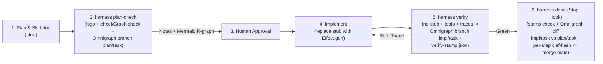

# Effect-TS Engineering Harness — Project Brief (MVP v2)

Oct 24, 2026 · @Roman Selmeci  
Supersedes: [docs/mvp.md](./mvp.md) (MVP v1, Oct 3–4, 2026)

---

## 0. Why MVP v2 Exists — Research Findings & Architectural Diff vs. MVP v1

Before implementing Phase 1 of [docs/mvp.md](./mvp.md), we conducted a source-level technical audit against the actual codebases and release artifacts of every tool in the stack (`vitali87/code-graph-rag`, `effect@4.0.0`, `@effect/ai-typesafe@4.0.0`, `alchemy@2.0.0-beta.80`, `drizzle-orm`, `typescript@7.0.2` / `@effect/tsgo@0.48.0`, `oxlint@1.86.0`, `ModernRelay/omnigraph@0.14.0`, and the Claude Code hook protocol).

That audit uncovered **six architectural showstoppers** in MVP v1 that would have caused Phase 1–3 acceptance gates to fail in practice. MVP v2 preserves the core philosophy of MVP v1 (*deterministic gates first, Plan-as-Code in Effect v4 idioms, vendored knowledge subtrees, thin agent adapters, and bounded local decisions via Clef-flash*) while replacing broken external assumptions with an **Effect-native dual-layer graph architecture (`effect/Graph` + `Omnigraph v0.14.0`)**.

### 0.1 Empirical Research Findings (Root Causes for v2)

1. **`code-graph-rag` cannot index Effect-TS v4 idioms or resolve `tests_reaching` (Showstopper #1 — `code-graph-rag` replaced by `effect/Graph` + `Omnigraph` in v2):**
   - **Static parser blindness on `Effect.fn`, `Layer`, and `Context.Service`:** In `vitali87/code-graph-rag` (`codebase_rag/constants/ast_js.py` L102–106 and `codebase_rag/parsers/js_ts/utils.py` L456–496), any `variable_declarator` initialized with a `call_expression` (`JS_CALL_RESULT_VALUE_TYPES`) is treated as a call result rather than a function binding, and `NodeLabel.CONSTANT` is Python-only. As a result, `export const greet = Effect.fn("Sample.greet")(function* () {})` creates **no `greet` node** in Memgraph; the inner generator is indexed only as `<module>.anonymous_<line>_<col>`. Static call edges to `greet(...)` never bind.
   - **`tests_reaching` ignores `dynamic_workloads` (`workloads`):** MVP v1 assumed that attaching `workloads: [testId]` to JSONL trace records would allow `code-graph-rag`'s `tests_reaching` MCP tool to return the tests exercising a use case or repository method. Inspection of `codebase_rag/cypher_queries.py` (`CYPHER_DEAD_CODE_RELS`, L914–920) and `codebase_rag/graph_query.py` (`ReachIndex`, L1125–1205) proved that `tests_reaching` **never inspects `r.dynamic_workloads`**—it performs a purely structural reverse BFS over `CALLS | REFERENCES | INSTANTIATES` edges until it reaches a node in a test file.
   - **Missing `(Test) -> (UseCase)` root span edge:** Because an `@effect/vitest` test body (`it.effect("...", () => Effect.gen(...))`) is not wrapped in `Effect.fn`, the top-level use case span has `parent = None`. A converter emitting `parent -> child` `Effect.fn` pairs emits **zero records** for single-span use cases and **never emits a `(TestNode) -> (UseCase)` edge**, causing `tests_reaching` to return `[]` 100% of the time.
   - **Zero Effect `HttpApi` endpoint support & heavy Docker/Memgraph overhead:** `codebase_rag/parsers/endpoint_routes.py` only recognizes Express, Fastify, Hapi, Flask/FastAPI, and Go `net/http` (emitting `[]` for Effect `HttpApi`), while requiring Docker + Memgraph + Python 3.12 + a background daemon.
   - **v2 Resolution (`effect/Graph` + `Omnigraph v0.14.0`):**
     - **In-memory Effect graph computation (`effect/Graph`):** `effect@4.0.0` ships a built-in 7,000-line functional graph engine (`import * as Graph from "effect/Graph"`) with `DirectedGraph<N, E>`, `bfs`, `dfs`, `topo`, `dijkstra`, `simplePaths`, `findCycle`, `stronglyConnectedComponents`, `difference`, `toSnapshot`, and `toMermaid`. `libs/harness/graph` uses `effect/Graph` for sub-millisecond deterministic policy checks (`effect-graph:check`) and Mermaid diagram generation.
     - **Persistent, branchable property graph & MCP (`Omnigraph v0.14.0`):** Instead of `code-graph-rag`, `libs/harness/graph` and `libs/harness/ingest` load our custom Effect schema (`schema.pg`) and NDJSON batches into **Omnigraph** (`@modernrelay/omnigraph@0.14.0` + `@modernrelay/omnigraph-mcp@0.14.0`, MIT, Rust engine backed by local Lance/Arrow files in `.harness/omnigraph/`—zero Docker, zero Memgraph, zero Python). Omnigraph gives us declarative `.pg` schemas for Effect `R`/`E` channels and runtime test spans, **Git-style graph branching (`plan/<task>` vs. `impl/<task>` branch diffing and merging)**, vector embeddings (`@embed`) over `agent-patterns/*.md`, AWS Cedar access policies, and a native MCP server.

2. **The "Skeleton Typecheck vs. `E`/`R` Type Erasure" Paradox (Showstopper #2):**
   - MVP v1 requires the agent to write a plan skeleton (`Effect.fn` signatures with stub bodies) that passes `@effect/tsgo` typecheck and `oxlint`, after which a human reviews the plan by reading `E` and `R` types and `effect-graph:check` verifies `R` dependencies on the skeleton.
   - **Empirical proof:** In Effect v4, `Effect.fn("Name")(function* (input: Input) { return yield* Effect.die("todo") })` infers its return type from the generator body: **`Effect<never, never, never>`**. Both `E` and `R` collapse to `never`, blinding the human reviewer and `effect-graph:check`. Annotating `: Effect.Effect<A, E, R>` directly on `function*` fails with TypeScript `TS2739` (a JS generator returns `Generator`, requiring `Effect.fn.Return<A, E, R>`), and unused `input` parameters in stubs fail `oxlint` (`no-unused-vars`).
   - **v2 Resolution:** Introduce a canonical skeleton helper `stub<A, E = never, R = never>(..._usedArgs: ReadonlyArray<unknown>): Effect.Effect<A, E, R>`. It preserves exact `A, E, R` inference inside `Effect.fn`, consumes unused parameters cleanly for `oxlint`, allows `effect-graph:check` to audit the skeleton and commit it to an Omnigraph `plan/<task>` branch before implementation starts, and is banned by `oxlint` / `harness verify` in completed implementations.

3. **Clef-flash (9B) + Clef (27B) VRAM Thrashing, Timeout Contradiction, and Claude Code `Stop` Hook Mismatch (Showstopper #3):**
   - **VRAM overflow on RX 7900 XTX (24 GB):** In Ollama, `clef-flash:latest` (9B `Q8_0`, 11 GB weights + ~1.5 GB KV cache = **~12.5 GB VRAM**) and `clef:latest` (27B `Q4_K_M`, 18 GB weights + ~3.5 GB KV cache = **~21.5 GB VRAM**) require **34 GB VRAM** combined. Calling `clef` 27B in `harness done` forces Ollama to evict `clef-flash` and cold-load 18 GB from disk (**3.5–8 s**), and the next `harness guard` evicts `clef` 27B to reload `clef-flash` (**2.5–5 s**).
   - **100% guaranteed timeout & `@effect/ai-typesafe` schema limits:** Wrapping calls in a *"few hundred ms"* `Effect.timeout` guarantees 100% timeout failures on model swap. Moreover, `@effect/ai-typesafe@4.0.0` (`TypeSafeSchema.ts`) only accepts `{ model, state, questions }` (no `keep_alive` or `options.num_ctx`), and Ollama caps `num_ctx` at `16384` (silently truncating full git diffs).
   - **System 1 classifier vs. `Stop` hook protocol:** Clef is a non-autoregressive System 1 classifier that outputs probabilities over fixed labels; it cannot generate free-text explanations (*"block with reasons"*). Furthermore, Claude Code's `Stop` hook specification only supports `{"decision": "block", "reason": "..."}`—it does **not** support `"permissionDecision": "ask"`.
   - **v2 Resolution:** Standardize on **a single resident local model (`clef-flash` 9B)** kept warm in VRAM (~12.5 GB, ~40 ms latency). Replace the monolithic Clef 27B diff check in `harness done` with: (a) a **cryptographic working-tree hash check** (`.harness/verify-stamp.json`), (b) **deterministic graph diffing** (`Graph.difference` in `effect/Graph` + `og.branches.diff` in Omnigraph between `impl/<task>` and `plan/<task>`), and (c) **per-step `clef-flash` classification** over focused per-step diffs, returning `{"decision": "block", "reason": "..."}` naming the exact failing step.

4. **Toolchain & Package Pin Discrepancies (Showstopper #4):**
   - **Drizzle version mismatch:** `drizzle-orm@0.45.3` does not contain `drizzle-orm/effect-d1`, `drizzle-orm/effect-sqlite-do`, or `drizzle-orm/effect-core`. `alchemy@2.0.0-beta.80` requires peer dependencies **`drizzle-orm@1.0.0-rc.5-ab785fc`** and **`drizzle-kit@1.0.0-rc.5-ab785fc`**.
   - **TypeScript 7 (`typescript@7.0.2` / `tsgo`) removed the JS Compiler API:** `require("typescript")` in `7.0.2` exports only `{ version: "7.0.2", versionMajorMinor: "7.0" }` (`ts.createProgram === undefined`). Tools requiring the in-process JS Compiler API (`@nx/oxlint`, `nx`, and `ts-morph` in `libs/harness/graph`) resolve `typescript@5.9.3` via scoped workspace overrides / package aliases while the root typechecker stays `typescript@7.0.2` (`tsgo`).
   - **`@effect/language-service` `"diagnostics": false` & `oxlint` rules:** `"diagnostics": false` in `tsconfig.base.json` silences `tsc --noEmit` diagnostics and must be omitted. Syntax bans live in `tools/oxlint/syntax-bans.js` (since `oxlint@1.86.0` lacks `no-restricted-syntax`), and `no-restricted-imports` uses `patterns` (`drizzle-orm/*`, `alchemy/*`, `@effect/sql-*`) rather than exact `paths`.

5. **Distributed Tracing Across `Vitest (Node) <-> workerd <-> Durable Object RPC` (Showstopper #5):**
   - W3C `traceparent` headers carry `trace_id` and `span_id`, not `test_id`. And native Cloudflare Durable Object stubs (`makeRpcStub` in Alchemy) do not propagate W3C headers across method calls.
   - **v2 Resolution:** Route internal `RpcClient` calls into Durable Objects over `Cloudflare.toHttpClient(doStub)` (preserving W3C `traceparent` headers through the DO `fetch` handler), and correlate `workerd` spans with the Vitest root `TestSpan` by shared `trace_id` inside `@harness/ingest`.

### 0.2 Summary Diff Table: MVP v1 vs. MVP v2

| Dimension | MVP v1 (`docs/mvp.md`) | MVP v2 (`docs/mvp_v2.md`) |
| :--- | :--- | :--- |
| **Code Intelligence & Graph Engine** | External `code-graph-rag` (Python 3.12 + Docker + Memgraph + syntactic tree-sitter). | **Dual-Layer Effect Graph:**<br>1. **`effect/Graph`** (built into `effect@4.0.0`) for in-memory topological checks, cycle detection, `Graph.difference`, and `Graph.toMermaid`.<br>2. **Omnigraph `v0.14.0`** (`@modernrelay/omnigraph` + `@modernrelay/omnigraph-mcp`, Rust on local Lance/Arrow files in `.harness/omnigraph/`, no Docker/Memgraph) with declarative `.pg` schema, Git-style graph branching (`plan` vs. `impl`), vector `@embed` search, and Cedar policies. |
| **Machine Prerequisites** | `pnpm`, Node ≥ 24, Docker, Memgraph, Python 3.12+, cmake, ripgrep, Ollama (`clef-flash` + `clef` 27B). | **`pnpm` (Node ≥ 24), `omnigraph` single Rust binary (`v0.14.0`), and Ollama (`clef-flash` 9B only)**. Zero Docker, zero Python. |
| **Plan Skeleton Stubs** | Unspecified stub body (`Effect.die` erases `E` and `R` to `never`). | Canonical **`stub<A, E, R>(...args)`** helper in `@harness/gates`; preserves inferred `A, E, R` on `Effect.fn`, satisfies `no-unused-vars`, commits to Omnigraph `plan/<task>` branch, and is banned in `harness verify`. |
| **Test Trace Correlation** | `parent -> child` `Effect.fn` pairs ingested into Memgraph; relied on `cgr`'s `tests_reaching`. | `@effect/vitest` tracer Layer wraps each test in a synthetic **root `TestSpan`**, correlates `workerd` spans by `trace_id`, and bulk-loads `TracedCall` and `ExercisesSpan` edges into Omnigraph via `og.load({ mode: "merge" })`. |
| **Decision Models** | `clef-flash` (9B) for hot path + `clef` (27B) on-demand for `harness done`; ~300 ms timeout everywhere. | **Single resident `clef-flash` (9B)** in VRAM (~12.5 GB, no swapping). Warm-up ping in `harness session` (10 s timeout); 1500 ms warm timeout on calls. |
| **Done Gate (`harness done`)** | `verify` green flag + Clef 27B over full diff (`allow` / `block` / `ask`). | 1) Cryptographic tree-hash stamp (`.harness/verify-stamp.json`), 2) Deterministic graph diff (`Graph.difference` + `og.branches.diff` between `impl/<task>` and `plan/<task>`), 3) Per-step `clef-flash` check, 4) `og.branches.merge` into `main`. Outputs Claude Code `Stop` JSON (`{"decision": "block", "reason": "..."}`). |
| **Drizzle & TS Compiler API Pins** | `drizzle-orm@0.45.3`, `drizzle-kit@0.31.11`; `ts-morph` assumed on `typescript@7.0.2`. | **`drizzle-orm@1.0.0-rc.5-ab785fc`**, **`drizzle-kit@1.0.0-rc.5-ab785fc`** (required by `alchemy@2.0.0-beta.80`); `typescript@5.9.3` scoped override/alias for JS Compiler API consumers (`ts-morph`, `@nx/oxlint`). |
| **Import & Syntax Bans** | `.oxlintrc.json` `no-restricted-syntax` + `paths: ["drizzle-orm"]`; `"diagnostics": false` in `tsconfig.base.json`. | Custom oxlint JS plugin `tools/oxlint/syntax-bans.js` (including `stub()` ban in `verify` mode) + `no-restricted-imports` `patterns` (`drizzle-orm/*`, `alchemy/*`, `@effect/sql-*`); `"diagnostics": false` omitted from `tsconfig.base.json`. |
| **Durable Object RPC Tracing** | Transport unspecified. | Effect `RpcGroup` / `RpcClient` over **`Cloudflare.toHttpClient(doStub)`** so W3C `traceparent` headers propagate end-to-end into `workerd`. |

---

## 1. Project Intent

The goal is a development harness in which an AI agent plans and codes in the idioms and building blocks of **Effect-TS v4**, enforced deterministically rather than merely suggested in a prompt. The repo runs on **pnpm + Nx**, a dual-layer Effect graph (**`effect/Graph`** in-memory + **Omnigraph `v0.14.0`** on local Lance storage) indexes the type-checked `Effect<A, E, R>` / `Layer<ROut, E, RIn>` structure, runtime test spans, and pattern files, and the **`clef-flash` (9B) decision model via Ollama** makes bounded local decisions.

The harness is **agent-agnostic**: all logic lives in the repo as Effect libraries, a CLI, and MCP tools. Each agent gets only a thin adapter. The first adapter prototype targets **Claude Code** (skill, `AGENTS.md`, hooks).

The MVP is exercised on a small sample app whose cloud infrastructure is declared with **Alchemy v2**, an Effect-native infrastructure-as-code tool, so infrastructure follows the same idioms, gates, and traces as application code.

---

## 2. Goals and Non-Goals

The MVP must show that an agent in this harness produces idiomatic Effect v4 code with fewer fix-up iterations than without it.

**MVP v2 Goals**

1. Before writing implementation code, the agent produces a plan in Effect terms and a skeleton using `stub<A, E, R>(...args)` that passes typecheck, preserves exact `A`, `E`, and `R` types, and snapshots the planned graph to an Omnigraph `plan/<task>` branch.
2. Every change passes deterministic gates: `@effect/tsgo` with Effect diagnostics, `oxlint` with the `effecttsgo` preset and `tools/oxlint/syntax-bans.js`, and `nx affected -t verify`.
3. Runtime test traces from Effect spans (including a synthetic root `TestSpan` per test) feed `effect/Graph` and Omnigraph from Phase 1, so the agent queries runtime-confirmed `TracedCall` and `ExercisesSpan` edges (`receiver_types`, reaching tests) through `.gq` queries and MCP tools.
4. The `R` channel works as a capability manifest: `effect-graph:check` (using `effect/Graph` algorithms) catches layer-rule violations (domain requiring infra services or cloud bindings), backed by static `oxlint` import pattern bans (`drizzle-orm/*`, `alchemy/*`, `@effect/sql-*`).
5. The sample app's infrastructure is Effect code too (Alchemy Layers), covered by the same gates and emulated tests.
6. The agent reads a pinned Effect and Alchemy source (`repos/effect`, `repos/alchemy`) and reviewed pattern files (`agent-patterns/*.md`, indexed in Omnigraph), not external docs.
7. A single resident `clef-flash` (9B) model in Ollama handles only the semantic remainder: pre-tool safety gate, advisory idiom router, failure triage, and per-step plan coverage in `harness done`.
8. The core runs without an agent (CLI and CI); the Claude Code adapter is thin.

**MVP v2 Non-Goals**

- Docker/Memgraph/Neo4j/`code-graph-rag` or Python daemons.
- Running a second 27B local model (`clef` 27B) alongside `clef-flash` on a single 24 GB GPU.
- Adapters for OpenCode and DeepSeek Harness (only confirm the design does not rule them out).
- Production trace overlay (eBPF or OpenTelemetry from live deployed services); MVP traces tests only.
- Alchemy live stages, per-PR preview deploys, and production monitoring.
- Postgres via Hyperdrive, Kysely, browser end-to-end tests.
- Fine-tuning the decision model.

---

## 3. Architecture

All logic lives in Effect libraries in the repo; the CLI and MCP servers expose it, and each agent gets only a thin adapter. CI calls the same CLI (using pure in-memory `effect/Graph` snapshots when `omnigraph-server` is not needed), so every gate also runs without an agent.

```
libs/harness/
  decision/      DecisionModel definitions over effect/ai + @effect/ai-typesafe (clef-flash)
  ingest/        Effect.fn static index, @effect/vitest recording tracer (with root TestSpan), workerd OTel correlation
  graph/         effect/Graph builder & algorithms, schema.pg, @modernrelay/omnigraph sync & branch diffing, @ast-grep/napi
  gates/         stub<A, E, R> helper, guard policy, verify tree-hash stamp, plan-check & done verifiers
apps/harness-cli/      harness guard | route | plan-check | verify | done | ingest | session | doctor
apps/harness-mcp/      Effect MCP server (harness_route, harness_resolve, harness_callers, harness_callees, harness_tests_reaching, harness_structural_search)
adapters/
  claude-code/   plugin: hooks.json -> harness-cli, .mcp.json -> harness-mcp + @modernrelay/omnigraph-mcp + nx-mcp, skill
repos/
  effect/        squashed subtree, read-only
  alchemy/       squashed subtree, read-only
agent-patterns/  reviewed pattern files (also indexed as PatternDoc nodes in Omnigraph)
AGENTS.md        agent-neutral rules
```

Each core part is an Effect service with a Layer (`DecisionModel`, `Ingest`, `EffectGraph`, `OmnigraphClient`, `Gate`), so tests swap in deterministic mock Layers and CI can run all gates purely on `effect/Graph` snapshots without external processes.

---

## 4. Workflows

One task runs: **plan → plan-check (`plan/<task>` branch) → human approval → implement → verify (`impl/<task>` branch) → done (diff & merge to `main`)**.



### 4.1 Where Effect Devtools, `effect/Graph` + `Omnigraph`, and `effect/ai` Sit

| Step | Tool | How it is used |
| :--- | :--- | :--- |
| **Plan** | `harness-mcp` + `@modernrelay/omnigraph-mcp` + Nx generators + `stub<A, E, R>` | Agent queries existing services/schemas in Omnigraph (`main` branch), calls `harness_route` per step, scaffolds contracts/services/use-cases, and writes stub bodies with `stub<A, E, R>(...args)`. |
| **Plan check** | `harness plan-check` (`@effect/tsgo` + `oxlint` + `effect-graph:check` + Omnigraph branch `plan/<task>`) | Skeleton typechecks with preserved `E` and `R` types; `effect/Graph` validates layer boundaries and renders a `Graph.toMermaid` diagram of the planned `R` / `Layer` topology; creates Omnigraph branch `plan/<task>` and loads the skeleton nodes/edges. |
| **Implement** | `@effect/tsgo` + `oxlint` (`effecttsgo` + `harness/syntax-bans`) | Post-edit hook runs fast incremental checks; agent replaces `stub<A, E, R>` calls with real `Effect.gen` / `Effect.fn` bodies. |
| **Verify** | `harness verify` (`@effect/vitest`, Alchemy `Test.make`, `tsgo`, `oxlint` with `no-stub`, trace ingest) | Runs `nx affected -t verify` with no `stub()` allowed, loads the updated static graph + runtime test trace edges into Omnigraph branch `impl/<task>`, saves `Graph.toSnapshot` to `.harness/graph-snapshot.json`, and writes the cryptographic working-tree stamp `.harness/verify-stamp.json`. |
| **Done** | `harness done` (Stop hook) | Verifies `.harness/verify-stamp.json` matches current working tree SHA-256, runs `Graph.difference` + `og.branches.diff({ source: "impl/<task>", target: "plan/<task>" })` to prove all planned capabilities/errors/services match, runs per-step `clef-flash` checks, and merges `impl/<task>` into `main` (`og.branches.merge`). |
| **Human escalation** | VS Code Effect extension | Debugger with fiber context, span stack, fiber list, and pause on defect. |

### 4.2 Where Each `clef-flash` Call Sits

Deterministic rules always run first; `clef-flash` sees only what they leave open, and on timeout or Ollama down the safer outcome wins.

| Touchpoint | Triggered by | Decided deterministically first | What `clef-flash` (9B) decides | Outcome & Claude Code Hook Mapping |
| :--- | :--- | :--- | :--- | :--- |
| **Idiom router** | Agent calls `harness_route` (MCP) per plan step | Nothing | Which Effect building block fits the step (`fitsAny` probability + `block` classification) | Pattern file to load, or `review`; **advisory only** |
| **Router re-run** | `harness plan-check` | Skeleton typecheck, lint, `effect-graph:check` | Same question over all plan steps | Mismatches become notes for the human; never a block |
| **Safety guard** | `PreToolUse` hook (`harness guard`) | Allowlist (`nx`, `pnpm test`, `pnpm verify`), Asklist (`alchemy deploy`/`destroy`/`profile`), Denylist (`rm -rf`, `.env`, `push --force`) | Unknown commands only: destructive, secret access, exfiltration, off-task | `allow` (exit 0), `deny` (exit 2), or `ask` (exit 0 + `permissionDecision: "ask"` JSON) |
| **Failure triage** | Inside `harness verify` | Known `tsgo` / `oxlint` diagnostic codes mapped to `"mechanical"` + pattern snippet | Unmapped failures (typically test assertions) | Grouped output: mechanical with fix hints, semantic with Omnigraph neighborhood context |
| **Plan coverage** | `Stop` hook (`harness done`) | 1) `.harness/verify-stamp.json` matches current tree hash, 2) `og.branches.diff` / `Graph.difference` confirms all `plan/<task>` symbols exist in `impl/<task>` with matching `E`/`R` and zero `stub()` | Per-step check (`{ planStep, stepDiff }`): is this step implemented (`noul`), any unrelated changes (`noul`) | `allow` (exit 0, merges `impl/<task>` -> `main`) or `block` (exit 0 + `{"decision": "block", "reason": "..."}` naming the failing step) |

---

## 5. Knowledge Layer

The agent learns Effect v4 and Alchemy v2 from the source code and tests of pinned versions in the repo, never from unpinned web docs.

- **Subtrees:**
  - `git subtree add --prefix=repos/effect https://github.com/Effect-TS/effect.git main --squash`
  - `git subtree add --prefix=repos/alchemy https://github.com/alchemy-run/alchemy.git main --squash`
- **`repos/` is read-only:** Never edit it, never import from it. Excluded from search, file watching, auto-imports, lint, and Nx project inference.
- **Vendored Alchemy doc snapshots:** `docs/alchemy-llms.txt` and `docs/alchemy-llms-full.txt` snapshotted at pin time for offline/CI lookups.
- **Pattern files in `agent-patterns/`:** Generated from vendored sources, human-reviewed, and indexed as `PatternDoc` nodes in Omnigraph (`services-and-layers.md`, `errors.md`, `schema.md`, `resources-scope.md`, `concurrency.md`, `schedule.md`, `testing.md`, `planning.md`, `alchemy-infra.md`, `d1-repository.md`, `durable-object-state.md`, `httpapi.md`, `rpc.md`, `atom.md`).

**Order of authority in `AGENTS.md`:**
1. `repos/effect/LLMS.md`
2. Source code and tests in `repos/effect` and `repos/alchemy`
3. `agent-patterns/*.md` and `docs/alchemy-llms*.txt`
4. `effect/Graph` + Omnigraph (`harness-mcp` / `@modernrelay/omnigraph-mcp`) and the Nx graph for services and Layers

---

## 6. Planning in Effect Idioms & The `stub<A, E, R>` Skeleton Pattern

A plan is written in Effect building blocks (`Schema`, tagged errors, `Context.Service`, `Layer`, Drizzle D1 / Durable Object tables, `HttpApi`, `RpcGroup`, `AtomHttpApi`, Alchemy resources/bindings, `Effect<A, E, R>` use cases, `Scope`, `Schedule`, `Config`, and test Layers).

### Plan as Code with `stub<A, E, R>(...args)`

To prevent `Effect.die` from erasing `E` and `R` to `never` during skeleton creation (Showstopper #2), `@harness/gates` exports:

```ts
import { Effect } from "effect"

export const stub = <A, E = never, R = never>(
  ..._usedArgs: ReadonlyArray<unknown>
): Effect.Effect<A, E, R> => Effect.die("HARNESS_PLAN_STUB")
```

During the **Plan** phase, the agent writes use-case skeletons as:

```ts
export const checkout = Effect.fn("Cart.checkout")(function* (input: CheckoutInput) {
  return yield* stub<CheckoutReceipt, OutOfStockError | PaymentError, InventoryRepo | PaymentService>(input)
})
```

1. **In `harness plan-check` (`HARNESS_PLAN_CHECK=1`):** `stub<A, E, R>(input)` is **allowed**. TypeScript infers the exact `Effect<CheckoutReceipt, OutOfStockError | PaymentError, InventoryRepo | PaymentService>` return type, `input` is marked used for `oxlint`, `effect-graph:check` validates `R` against layer boundaries, `Graph.toMermaid` outputs the visual dependency topology for the human reviewer, and the skeleton graph is committed to Omnigraph branch `plan/<task>`.
2. **In `harness verify`:** `stub(...)` is **banned** (enforced by `tools/oxlint/syntax-bans.js`), ensuring no unimplemented stub can pass verification.

---

## 7. Gates and Feedback

Deterministic gates come first and always win; the decision model never overrides them.

| Gate | What it catches | How it is wired |
| :--- | :--- | :--- |
| **`@effect/tsgo`** (TypeScript 7 native + Effect diagnostics) | Floating Effects, Layer requirement leaks, redundant `Effect.gen`/`pipe`, catch on infallible Effects | `prepare: effect-tsgo patch --oxlint`; `tsconfig.base.json` with `"diagnosticSeverity": { "floatingEffect": "error" }` (and `"diagnostics": false` **omitted** so `tsc --noEmit` emits errors). |
| **`oxlint` + `effecttsgo` preset** | 83 type-aware Effect lint rules | `.oxlintrc.json` extends `./node_modules/@effect/tsgo/oxlint-presets/recommended.json`. |
| **Custom syntax & import bans** | `async`/`await`, `new Promise`, `try`/`catch`, `throw`, raw `JSON.parse`; `drizzle-orm/*`, `alchemy/*`, `@effect/sql-*` outside `type:infra` / `type:app`; `stub()` in `verify` | `jsPlugins: ["./tools/oxlint/syntax-bans.js"]` (`harness/syntax-bans`) + `no-restricted-imports` with `patterns: [{ group: ["drizzle-orm", "drizzle-orm/*", "alchemy", "alchemy/*", "@effect/sql-*"] }]`. |
| **`@nx/enforce-module-boundaries`** | Forbidden dependencies between `type:contract`, `type:domain`, `type:service`, `type:infra`, `type:app` | `@nx/oxlint/boundaries-plugin` in `.oxlintrc.json` (with `typescript@5.9.3` override in `pnpm-workspace.yaml` for `@typescript-eslint` / `nx`). |
| **`effect-graph:check`** | A domain use case whose `R` holds an infra service or cloud binding; a top-level cloud resource outside `type:infra`/`type:app`; cyclic `Layer` dependencies (`Graph.findCycle`) | Cacheable Nx target powered by `libs/harness/graph` (`effect/Graph`). |
| **Migration drift check** | Drizzle schema changed without a committed migration; destructive SQL (`DROP`, table rebuild) | `drizzle-kit generate` (`1.0.0-rc.5-ab785fc`) into a temp dir must add nothing; exit 1 on uncommitted drift, exit 2 (human escalation) on `DROP`. |
| **`oasdiff breaking`** | Breaking change of the public `HttpApi` | Compares committed `openapi.json` (`contract:openapi`) against `main`; ERR escalates, WARN is a note. |
| **`harness verify`** | Composite gate + trace ingest + cryptographic stamp | Runs `nx affected -t verify`, rejects any remaining `stub()`, syncs static + trace graph to Omnigraph (`impl/<task>`) and `.harness/graph-snapshot.json`, and writes `.harness/verify-stamp.json` (SHA-256 of working tree). |

---

## 8. Dual-Layer Code & Trace Graph: `effect/Graph` + `Omnigraph v0.14.0`

MVP v2 combines **Effect v4's built-in `effect/Graph` module** (for zero-dependency, in-process functional graph algorithms and CI gates) with **ModernRelay Omnigraph `v0.14.0`** (`@modernrelay/omnigraph@0.14.0` + `@modernrelay/omnigraph-mcp@0.14.0`, for declarative `.pg` property graphs, Git-style branch diffing, Cedar access control, and agent MCP queries on local Lance storage).

### 8.1 Layer 1: In-Memory Functional Graph (`effect/Graph` in `libs/harness/graph`)

- Uses a package-scoped TypeScript 5.9 (`typescript-js: npm:typescript@5.9.3` with `ts-morph`) to extract all exported Effect symbols (`Effect.fn`, `Context.Service`, `Layer`, `Schema`, `TaggedError`, `HttpApi`, `RpcGroup`) into an immutable `Graph.DirectedGraph<HarnessNode, HarnessEdge>`.
- Runs deterministic, sub-millisecond checks in `effect-graph:check`:
  - `Graph.findCycle(layerGraph)` — catches circular Layer dependencies.
  - `Graph.simplePaths(graph, domainNode, infraOrBindingNode)` — finds and prints the exact dependency chain when a `type:domain` use case leaks an infrastructure `Context.Service` or Alchemy `Binding`/`Provider` into `R`.
  - `Graph.difference(implGraph, planGraph)` — computes structural graph diffs in memory (used alongside Omnigraph branch diffs).
  - `Graph.toMermaid(subgraph)` — renders visual architecture diagrams of `R` requirements and `Layer` wiring during `harness plan-check`.
  - `Graph.toSnapshot(graph)` — persists `.harness/graph-snapshot.json` so CI can run every graph gate deterministically without starting a server.

### 8.2 Layer 2: Branchable Property Graph & MCP (`Omnigraph v0.14.0`)

- **Local storage, zero Docker:** Initialized via `omnigraph init --schema libs/harness/graph/schema.pg .harness/omnigraph` (backed by Lance columnar files on disk) and served locally on `127.0.0.1:8080` by `omnigraph-server`.
- **Declarative Schema (`libs/harness/graph/schema.pg`):**

```pg
node EffectFn {
  qualname: String @key
  spanName: String @index
  packageTag: enum(contract, domain, service, infra, app) @index
  file: String @index
  line: I32
  successType: String
  isStub: Bool @index
}

node ServiceTag {
  tagId: String @key
  name: String @index
  packageTag: enum(contract, domain, service, infra, app) @index
  file: String @index
}

node ServiceLayer {
  qualname: String @key
  layerKind: enum(live, test, emulated, infra) @index
  packageTag: enum(contract, domain, service, infra, app) @index
  file: String @index
}

node TaggedError {
  errorTag: String @key
  file: String @index
}

node VitestCase {
  testId: String @key
  testFile: String @index
  testName: String @index
  lastTreeHash: String
}

node PatternDoc {
  slug: String @key
  path: String @index
  summary: String @index
}

edge RequiresService: EffectFn -> ServiceTag @card(0..) {
  @unique(@src, @dst)
}

edge FailsWith: EffectFn -> TaggedError @card(0..) {
  @unique(@src, @dst)
}

edge ProvidesService: ServiceLayer -> ServiceTag @card(0..) {
  @unique(@src, @dst)
}

edge LayerRequires: ServiceLayer -> ServiceTag @card(0..) {
  @unique(@src, @dst)
}

edge TracedCall: EffectFn -> EffectFn @card(0..) {
  callCount: I64
  receiverLayer: String?
  @unique(@src, @dst)
}

edge ExercisesSpan: VitestCase -> EffectFn @card(0..) {
  callCount: I64
  receiverLayer: String?
  @unique(@src, @dst)
}
```

- **Bulk Sync via `@modernrelay/omnigraph@0.14.0`:**
  `libs/harness/graph` and `libs/harness/ingest` convert `effect/Graph` nodes/edges and test trace records into NDJSON and upsert them in one call via `og.load({ branch, mode: "merge", data })`.
- **Git-Style Graph Branching Across the Task Lifecycle:**
  1. `harness plan-check`: `await og.branches.create({ name: "plan/current", from: "main" })` and loads the skeleton graph (`isStub: true`, `RequiresService`, `FailsWith`).
  2. `harness verify`: `await og.branches.create({ name: "impl/current", from: "main" })` and loads the implemented graph (`isStub: false`) plus `TracedCall` and `ExercisesSpan` edges from `@effect/vitest`.
  3. `harness done`: calls `await og.branches.diff({ source: "impl/current", target: "plan/current" })` to verify that all planned `EffectFn`, `ServiceTag`, `RequiresService`, and `FailsWith` entities exist with `isStub: false`, then merges `impl/current` into `main` (`await og.branches.merge({ source: "impl/current", target: "main" })`).
- **Cedar Policy Enforcement:**
  The agent's MCP bearer token is restricted by Omnigraph's Cedar policy to `read` actions only on `main` and `plan/*`; only the `harness` CLI token holds `change`, `branch_create`, and `branch_merge` permissions, preventing the agent from tampering with the graph state directly.

### 8.3 Runtime Test Tracer (`libs/harness/ingest`)

1. **Naming rule (lint-enforced):** Every exported use case and service method is an `Effect.fn("Scope.Module.name")` with a unique literal span name.
2. **Synthetic Root `TestSpan` in `@effect/vitest`:** Our test `Tracer` Layer automatically opens a root span `Test:<relativeTestFile>:<testName>` for each `it.effect` execution. Every `Effect.fn` span executed during the test records an `ExercisesSpan` edge from `VitestCase` to `EffectFn` (including leaf use cases with no child calls) and `TracedCall` edges between parent and child `Effect.fn` spans.
3. **Cross-Process `workerd` Trace Correlation:**
   - `HttpApiClient` and `RpcClient` (routed over `Cloudflare.toHttpClient(doStub)`) automatically propagate W3C `traceparent` (`trace_id` + `span_id`).
   - An OpenTelemetry span exporter in the emulated Worker writes spans with `trace_id` to a local trace file.
   - The converter joins `workerd` spans to the in-process `@effect/vitest` root `TestSpan` via their shared `trace_id`, recording `ExercisesSpan` and `TracedCall` edges across the `Node <-> workerd` boundary.

### 8.4 MCP Tools Exposed to the Agent

The agent accesses two complementary MCP servers configured in `.mcp.json`:
1. **`@modernrelay/omnigraph-mcp@0.14.0`** (read-only token): `query` (parameterized `.gq` graph queries), `snapshot`, `schema_get`, `branches_list`, `commits_list`, `commits_changes`.
2. **`apps/harness-mcp`** (high-level Effect shortcuts backed by `effect/Graph`, stored `.gq` queries in Omnigraph, and `@ast-grep/napi`):
   - `harness_resolve` — resolves a symbol or `spanName` to its `EffectFn` / `ServiceTag` / `ServiceLayer` node and full `A, E, R` signature.
   - `harness_callers` / `harness_callees` — traverses `RequiresService`, `ProvidesService`, and `TracedCall` edges (returning both static DI candidates and runtime `receiverLayer`).
   - `harness_tests_reaching` — runs a `.gq` match over `ExercisesSpan` + transitive `TracedCall` edges to return the exact `VitestCase` tests reaching a function or service.
   - `harness_structural_search` — fast AST pattern search via `@ast-grep/napi`.
   - `harness_route` — advisory `clef-flash` idiom router.

---

## 9. Infrastructure as Effect: Alchemy v2

- **Pinned version:** `alchemy@2.0.0-beta.80` (with `repos/alchemy` subtree and offline `docs/alchemy-llms*.txt` snapshots).
- **Capabilities in Layer types:** Resources (`Effect<Resource, never, Provider<Resource>>`) and bindings (`Binding.Service`) live inside `type:infra` Layers and `apps/sample/alchemy.run.ts`.
- **Two-pronged boundary enforcement:**
  1. `oxlint` `no-restricted-imports` with `patterns: ["alchemy", "alchemy/*"]` blocks any `alchemy` import outside `type:infra` and `type:app` (preventing top-level resource declarations in `type:domain`).
  2. `effect-graph:check` inspects `R` and `RIn` in `effect/Graph` to ensure no `Provider<*>` or `Binding.*` leaks into `type:domain` or `type:service`.
- **Safety guard:** `alchemy deploy`, `alchemy destroy`, and `alchemy profile` commands are on `ASKLIST` (always prompt the human via `PreToolUse` `permissionDecision: "ask"`). Credentials live exclusively in `~/.alchemy/profiles.json`.

---

## 10. Application Stack: Data, API, RPC, Frontend

| Tag | Holds | May import |
| :--- | :--- | :--- |
| `type:contract` | Schemas, `HttpApi`, `RpcGroup`, API errors | `effect` only |
| `type:domain` | Use cases, domain errors, pure deciders | `contract` (`@harness/gates` for `stub` in skeletons) |
| `type:service` | Service interfaces (`Context.Service`), including repositories | `contract`, `domain` |
| `type:infra` | Drizzle repositories (`1.0.0-rc.5-ab785fc`), HTTP/RPC handlers, Alchemy resources | `contract`, `domain`, `service`, `infra` |
| `type:app` (api) | Worker: composes Layers, `HttpApiBuilder`, `RpcServer`, `alchemy.run.ts` | everything |
| `type:app` (web) | Vite + React (`AtomHttpApi` over `@effect/atom-react`) | **`contract` and UI libraries only** |

- **Database:** `Drizzle.D1` (`drizzle-orm/effect-d1` on `@effect/sql-d1`) and `Drizzle.DurableObject` (`drizzle-orm/effect-sqlite-do` on `@effect/sql-sqlite-do`) using **`drizzle-orm@1.0.0-rc.5-ab785fc`** and **`drizzle-kit@1.0.0-rc.5-ab785fc`**.
- **Durable Object SQLite transactions:** Alchemy's `Drizzle.DurableObject` runs `withTransaction` on `Scheduler.MixedScheduler("sync")` to prevent Cloudflare async I/O interleaving. All operations inside a DO SQLite transaction (including `LocalProjection.apply` in `effect-es`) must be strictly synchronous DB effects; Schema decoding/encoding happens before entering `withTransaction`.
- **Internal RPC into Durable Objects:** Uses `RpcGroup` in `type:contract` and `RpcClient` over `Cloudflare.toHttpClient(doStub)` so both Effect's typed RPC protocol and W3C `traceparent` headers cross into the Durable Object cleanly.

---

## 11. Decision Model: Resident `clef-flash` (9B) via Ollama

- **Single model architecture:** Only `clef-flash` (9B `Q8_0`, ~12.5 GB VRAM with KV cache) is used locally on the RX 7900 XTX (24 GB VRAM). `clef` (27B) is **not** used locally, avoiding 34 GB VRAM overflow and multi-second disk thrashing.
- **Residency & Timeouts:**
  - `harness session` runs a warm-up decision call against `http://localhost:11434/v1/systemone` with a **10 s timeout** (and recommends `OLLAMA_KEEP_ALIVE=-1` on the Ollama service).
  - Hot-path calls (`guard`, `route`, `triage`, per-step `done`) use a **1500 ms timeout** (`Effect.timeout("1500 millis")`). On timeout or `AiError`, `guard` falls back to `ask`, `route` returns `review`, and `done` falls back to deterministic checks + human block note.
- **Done Gate (`harness done`) Without Clef 27B:**
  1. **Tree-Hash Stamp Check:** Verifies `.harness/verify-stamp.json` matches the current working tree SHA-256 (`git rev-parse HEAD` + `git status --porcelain` + file hashes). If stale or missing, returns `{"decision": "block", "reason": "Run harness verify after your latest edits before finishing."}`.
  2. **Deterministic Graph Diff Check (`effect/Graph` + `Omnigraph`):** Runs `Graph.difference` and `og.branches.diff({ source: "impl/current", target: "plan/current" })`. Rejects if any planned `EffectFn` or `ServiceTag` is missing, any `isStub: true` remains, or any `RequiresService` / `FailsWith` edge drifted without re-running `harness plan-check`.
  3. **Per-Step `clef-flash` Check:** Iterates over each plan step `{ stepId, description, targetFiles }` with `PlanStepCoverageV1` (`Decision.probability` for `implemented` and `noOutOfScopeEdits`). If a step scores below threshold (`0.7`), returns `{"decision": "block", "reason": "Plan step <stepId> failed coverage check: ..."}`.
  4. **Branch Merge:** Once green, merges `impl/current` into `main` in Omnigraph (`await og.branches.merge({ source: "impl/current", target: "main" })`).

---

## 12. MVP v2 Phases & Acceptance Criteria

### Phases
1. **Phase 0 (Repo Bootstrap):** pnpm + Nx 23 monorepo, `@effect/tsgo` (`typescript@7.0.2` + `5.9.3` JS compiler overrides), `oxlint` (`effecttsgo` + `tools/oxlint/syntax-bans.js` + `patterns` import bans), `stub<A, E, R>`, vendored `repos/effect` and `repos/alchemy`, Drizzle (`1.0.0-rc.5-ab785fc`) migration drift gate, and `apps/sample` R2 stack.
2. **Phase 1 (Dual-Layer Graph & Test Traces):** `libs/harness/ingest` (recording `Tracer` Layer with synthetic root `TestSpan`), `libs/harness/graph` (`effect/Graph` builder + `schema.pg` + `@modernrelay/omnigraph@0.14.0` sync + `@ast-grep/napi`), and `apps/harness-mcp` + `@modernrelay/omnigraph-mcp@0.14.0`.
3. **Phase 2 (Decision Model & CLI/Hooks):** `libs/harness/decision` (`clef-flash` `IdiomRouterV1`, `GuardV1`, `TriageV1`, `PlanStepCoverageV1`), `apps/harness-cli` (`session`, `guard`, `route`, `plan-check`, `verify` with tree-hash stamp, `done` with Omnigraph branch diff/merge, `doctor`), and Claude Code adapter (`hooks.json`, `.mcp.json`, skill).
4. **Phase 3 (Type-Aware `effect-graph:check` & Skeleton Gate):** Full `A / E / R` and `Layer<ROut, E, RIn>` extraction into `effect/Graph` and Omnigraph, `effect-graph:check` enforcing domain/infra and cloud binding rules on both skeletons (`stub<A, E, R>`) and implementations, plus `Graph.toMermaid` output.
5. **Phase 4 (Full Sample App on Alchemy v2):** Contract (`HttpApi`, `RpcGroup`, `openapi.json` + `oasdiff`), `Drizzle.D1` + `Drizzle.DurableObject` (with `Cloudflare.toHttpClient` RPC and `workerd` trace correlation), and Vite + React (`AtomHttpApi`).
6. **Phase 5 (5-Task Benchmark):** Measured comparison of harness vs. no-harness on 5 tasks (diagnostics before first green `verify`, fix-up iterations, token usage).

### Acceptance Criteria (MVP v2)

The MVP v2 is accepted when every box below is ticked on a fresh clone with only **pnpm (Node ≥ 24), `omnigraph` (`v0.14.0`), and Ollama (`clef-flash`)** installed:

**Repo, Toolchain & Skeleton Gates**
- [ ] `pnpm install` patches TypeScript and oxlint via `prepare`; unassigned `Effect.log("x")` fails `tsc --noEmit`.
- [ ] `nx affected -t verify` runs `typecheck`, `lint`, and `test` and is the single definition of done.
- [ ] A `type:domain` lib importing a `type:infra` lib fails `@nx/enforce-module-boundaries`.
- [ ] Custom bans fail on `async`/`await`, `new Promise`, `try`/`catch`, `throw`, and raw `JSON.parse` inside `libs/` and `apps/` `src/`.
- [ ] `no-restricted-imports` `patterns` fail on `drizzle-orm`, `drizzle-orm/sqlite-core`, `alchemy`, `alchemy/*`, and `@effect/sql-*` outside `type:infra` and `type:app`.
- [ ] A use-case skeleton using `stub<Output, MyError, MyService>(input)` passes `tsc --noEmit` and `oxlint` during `harness plan-check` with inferred type `Effect<Output, MyError, MyService>`, and fails `harness verify` until `stub()` is replaced.
- [ ] `repos/effect` and `repos/alchemy` are squashed subtrees pinned to recorded commits; `LLMS.md` and `docs/alchemy-llms*.txt` are present.

**Dual-Layer Graph (`effect/Graph` + `Omnigraph v0.14.0`) & Runtime Traces**
- [ ] A lint rule fails any exported use case or service method that is not an `Effect.fn` with a unique literal name.
- [ ] `omnigraph init --schema libs/harness/graph/schema.pg .harness/omnigraph` initializes the local Lance-backed graph without Docker.
- [ ] `nx run <lib>:test:trace` executes `@effect/vitest` with the recording `Tracer` Layer (including the synthetic root `TestSpan`) and syncs `EffectFn`, `VitestCase`, `TracedCall`, and `ExercisesSpan` records into `effect/Graph` and Omnigraph (`og.load({ mode: "merge" })`).
- [ ] Calling `harness_callees` and `harness_callers` (or `.gq` queries via `@modernrelay/omnigraph-mcp`) resolves `EffectFn -> ServiceTag -> ServiceLayer` both statically (`RequiresService` / `ProvidesService`) and dynamically (`TracedCall`, `receiverLayer`).
- [ ] Calling `harness_tests_reaching` on both a leaf use case (`Sample.greet`) and a repository method returns the exact `VitestCase` nodes via `ExercisesSpan`.
- [ ] `effect-graph:check` (using `effect/Graph` `simplePaths` and `findCycle`) fails when a `type:domain` use case requires an infra service or cloud binding in `R` (including on a `stub<A, E, R>` skeleton), and `Graph.toMermaid` renders the dependency diagram.

**Infrastructure (Alchemy v2) & Application Stack**
- [ ] `apps/sample/alchemy.run.ts` typechecks; removing a binding from a Layer fails typecheck.
- [ ] `test:emulated` runs under `alchemy dev` emulation as part of `harness verify`, with nothing deployed.
- [ ] A D1 repository and a Durable Object both query through Drizzle (`drizzle-orm@1.0.0-rc.5-ab785fc`) on Effect; a wrong column name fails typecheck.
- [ ] Changing a Drizzle table without a committed migration fails `verify` (exit 1); a migration with `DROP` escalates to the human (exit 2).
- [ ] Internal RPC into a Durable Object runs over `RpcGroup` + `Cloudflare.toHttpClient(doStub)`, and `workerd` spans correlate with the Vitest root `TestSpan` via `trace_id`.
- [ ] The public `HttpApi` exports `openapi.json`; removing a response field fails `oasdiff breaking` and escalates.
- [ ] The React app reads data through `AtomHttpApi` built from the contract, with no hand-written `fetch` code.

**Decision Model (`clef-flash`) & Agent Loop (Claude Code)**
- [ ] `DecisionModel` is provided by `TypeSafeDecisionModel.layer({ model: "clef-flash" })` over `TypeSafeClient.layer({ apiUrl: "http://localhost:11434/v1" })`, and decodes a live call against Ollama without `AiError`.
- [ ] Only `clef-flash` (9B) is required locally; no 27B model is loaded or swapped.
- [ ] `harness guard` blocks `rm -rf` outside workspace and `.env`, allows `nx test`, returns `permissionDecision: "ask"` for `alchemy deploy`/`destroy`/`profile`, and asks a human when Ollama is down or times out (1500 ms warm timeout).
- [ ] `harness done` blocks (`{"decision": "block", "reason": "..."}`) if `.harness/verify-stamp.json` does not match the current working-tree SHA-256, if `og.branches.diff` between `impl/current` and `plan/current` shows missing symbols or remaining `isStub: true` nodes, or if per-step `clef-flash` coverage fails; when green, it merges `impl/current` into `main`.
- [ ] On 5 sample tasks, comparing harness vs. no-harness, the harness wins on at least 2 of 3 metrics (Effect diagnostics before first green `verify`, number of fix-up iterations, token usage).
