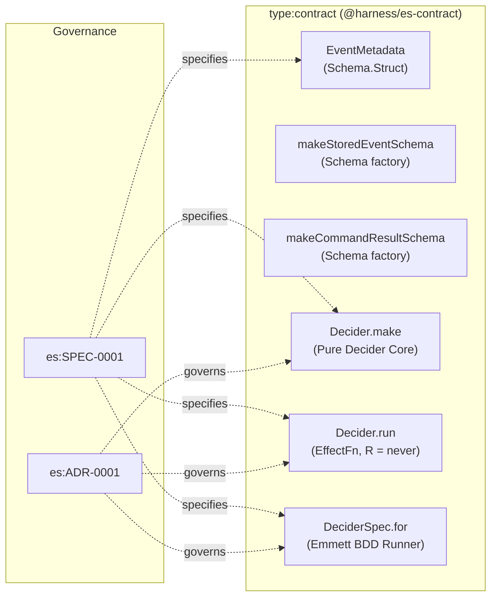

# es:SPEC-0001: Event Sourcing Decider Core and Emmett-Style Specification Runner

## Context

In `effect-es`, the event sourcing core is a pure, zero-dependency framework library decoupled from storage and application domains. In Phase 1 (Decider core), we establish the foundational framework contracts (`@harness/es-contract`) including `EventMetadata`, generic `CommandResult` schemas, `DeciderDefinition`, `Decider.make` with state folding, `Decider.run`, and Emmett-style `given/when/then` specification testing (`DeciderSpec.for`).
- **Reused Contracts / Errors:** None.
- **Reused Services:** None (`R = never` enforced for all deciders).
- **New Capabilities Needed:** `EventMetadata`, `makeStoredEventSchema`, `makeCommandResultSchema`, `CommandResult`, `DeciderDefinition`, `Decider.make`, `Decider.run`, `DeciderSpec.for`.

## Goal

Provide a pure, reusable Event Sourcing Decider core framework (`R = never`) with strongly-typed Effect Schemas, Emmett-style `given/when/then` BDD test specifications, and zero domain coupling in framework exports.

## How to read the requirements

Requirements follow EARS syntax. Each requirement is a single sentence with bold keywords (`When`, `While`, `If ... then`, `Where`) and the modal `shall` or `shall not`.

## Requirements

### 1 · Event Sourcing Framework Contracts & Decider Core
**Source (Event Sourcing MVP Brief, es:ADR-0001):** Defined in `docs/mvp_event_sourcing.md` and enforced in `libs/es/contract/src/index.ts` and `libs/es/contract/src/decider.ts`.

| ID | Pattern | Requirement | Effect Symbol | Verification |
| --- | --- | --- | --- | --- |
| REQ-1.1 | Ubiquitous | The EventMetadata contract schema **shall** validate non-empty aggregateId, commandId, correlationId, causationId, natural streamVersion, and integer timestamp fields. | EventMetadata | UnitTest |
| REQ-1.2 | Event-driven | **When** `Decider.make` is invoked with `initialState`, `evolve`, and `decide`, the Decider helper **shall** expose a deterministic `fold` function that reduces an event sequence into aggregate state. | Decider | PropertyTest |
| REQ-1.3 | Event-driven | **When** `DeciderSpec.for(decider).given(events).when(command)` is executed, the DeciderSpec runner **shall** verify emitted event partial matches via `thenEvents`. | DeciderSpec | UnitTest |
| REQ-1.4 | Event-driven | **When** `DeciderSpec.for(decider).given(events).when(command)` is executed and the decider emits no events, the DeciderSpec runner **shall** verify the no-op state via `thenNothing`. | DeciderSpec | UnitTest |
| REQ-1.5 | Event-driven | **When** `DeciderSpec.for(decider).given(events).when(command)` is executed and the decider fails, the DeciderSpec runner **shall** verify typed error tags via `thenFails` without infrastructure layers. | DeciderSpec | UnitTest |
| REQ-1.6 | Event-driven | **When** `Decider.run` is executed with a decider, command, and prior state, the Decider.run function **shall** decide events and sequentially fold all emitted events into the next aggregate state with `R = never`. | Decider.run | UnitTest |

## Assumptions

* **REQ-1.3:** `thenEvents` supports both declarative partial-match object arrays and custom assertion callbacks for flexible verification.
* **REQ-1.4:** Idempotent commands return empty event arrays `[]` rather than throwing errors.

## Out of scope

* **Application domain schemas (Cart, Inventory).** Maintained strictly as test fixtures and reference implementations, not exported by the framework package. Decides: Engineering team.
* **Durable Object SQLite storage and local projections.** Handled in Phase 2 (`Aggregate.durableObject` and `LocalProjection.make`). Decides: Engineering team.
* **Outbox, Cloudflare Queue delivery, and D1 cross-aggregate projections.** Handled in Phase 3 (`Projection.make` and `event_archive`). Decides: Engineering team.

## Known residual risks

* In-memory state folding (`Decider.fold`) processes the full aggregate event stream; streams growing beyond thousands of events will require snapshots in a post-MVP phase.

## Acceptance criteria

* All requirement rows pass their declared Verification methods (`UnitTest`, `PropertyTest`).
* Framework exports in `@harness/es-contract` contain zero business domain models.
* `harness gc --strict` and `harness verify` pass with 0 findings.

## Verified Plan Topology Graph

### Pre-Implementation Adversarial Plan Lens Summary

- [x] **Framework Isolation:** Domain-specific schemas (`Cart*`, `Inventory*`) are moved out of `@harness/es-contract` into `test/fixtures/`, preventing framework consumer bundle pollution.
- [x] **No-Op Semantics:** `DeciderSpec.thenNothing` explicitly validates that commands returning `[]` produce zero events and maintain prior aggregate state.
- [x] **Typed Error Verification:** `DeciderSpec.thenFails` checks typed tagged errors in the `E` channel without leaking or wrapping in untyped defects.
- [x] **Decider Purity:** Deciders require `R = never`, guaranteeing testability with zero mocks or cloud emulators.
