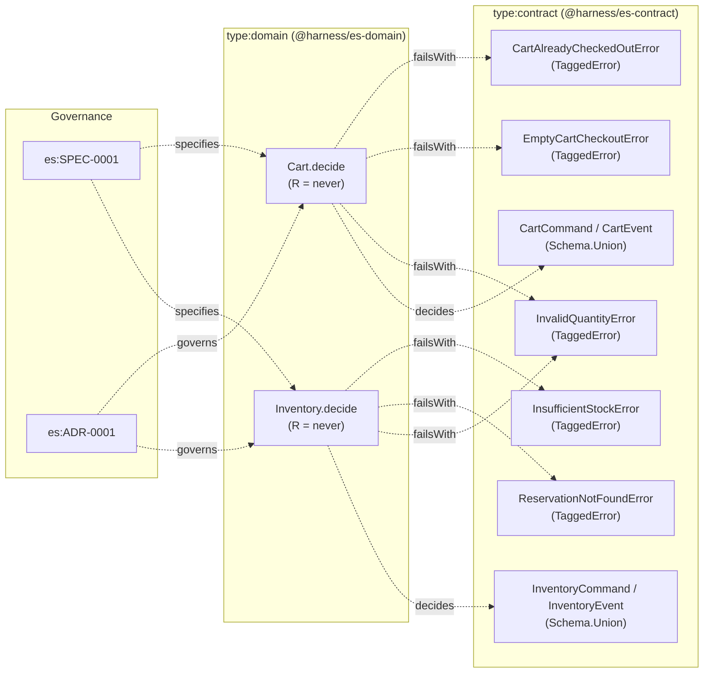

# es:SPEC-0001: Event Sourcing Decider Core and Sample Cart & Inventory Deciders

## Context

Event-sourced aggregates in `effect-es` separate pure domain decisions from Durable Object SQLite persistence and Cloudflare Queue delivery. In Phase 1 (Decider core), we establish the foundational contract schemas (`@harness/es-contract`) and pure decider primitives (`@harness/es-domain`) alongside two sample aggregates (`Cart` and `Inventory`) that will drive local projections, cross-aggregate D1 projections, and process managers in Phases 2 through 5.
- **Reused Contracts / Errors:** None (new `es` scope in `libs/es/`).
- **Reused Services:** None (`R = never` is strictly enforced for all deciders in Phase 1).
- **New Capabilities Needed:** `EventMetadata`, `CommandResult`, `CartCommand`, `CartEvent`, `CartState`, `InventoryCommand`, `InventoryEvent`, `InventoryState`, domain tagged errors, `Decider.make`, `DeciderSpec.for`, `Cart.decide`, and `Inventory.decide`.

## Goal

Provide a pure, zero-infrastructure Event Sourcing Decider core (`R = never`) with versioned Effect Schema commands and events, Emmett-style `given/when/then` BDD test specifications, and fully tested `Cart` and `Inventory` sample deciders verified by unit, property-based, and AST mutation tests.

## How to read the requirements

Requirements follow EARS syntax. Each requirement is a single sentence with bold keywords (`When`, `While`, `If ... then`, `Where`) and the modal `shall` or `shall not`.

## Requirements

### 1 · Event Sourcing Contracts & Decider Core
**Source (Event Sourcing MVP Brief, es:ADR-0001):** Defined in `docs/mvp_event_sourcing.md` and enforced in `libs/es/contract/src/index.ts` and `libs/es/domain/src/decider.ts`.

| ID | Pattern | Requirement | Effect Symbol | Verification |
| --- | --- | --- | --- | --- |
| REQ-1.1 | Ubiquitous | The EventMetadata contract schema **shall** validate non-empty aggregateId, commandId, correlationId, causationId, integer streamVersion, and integer timestamp fields. | EventMetadata | UnitTest |
| REQ-1.2 | Ubiquitous | The CartEvent and InventoryEvent contract schemas **shall** include a literal `version: 1` field on every event variant for schema evolution and round-trip serialization. | CartEvent | PropertyTest |
| REQ-1.3 | Event-driven | **When** `Decider.make` is invoked with `initialState`, `evolve`, and `decide`, the Decider helper **shall** expose a deterministic `fold` function that reduces an event sequence into aggregate state. | Decider | PropertyTest |
| REQ-1.4 | Event-driven | **When** `DeciderSpec.for(decider).given(events).when(command)` is executed, the DeciderSpec runner **shall** verify emitted event partial matches via `thenEvents`, no-op empty arrays via `thenNothing`, and typed error tags via `thenFails` without infrastructure layers. | DeciderSpec | UnitTest |

### 2 · Cart Aggregate Decider (`Cart.decide` & `evolveCart`)
**Source (Event Sourcing MVP Brief — Cart Aggregate):** Defined in `libs/es/domain/src/cart.ts`.

| ID | Pattern | Requirement | Effect Symbol | Verification |
| --- | --- | --- | --- | --- |
| REQ-2.1 | State-driven | **While** a CartState has `checkedOut` set to `false` and `AddCartItem` carries a positive `qty`, the Cart.decide decider **shall** emit an `ItemAdded` event with `version: 1`. | Cart.decide | PropertyTest |
| REQ-2.2 | State-driven | **While** a CartState contains an item with a matching `sku` and `RemoveCartItem` carries a positive `qty`, the Cart.decide decider **shall** emit an `ItemRemoved` event with `qty` clamped to the existing item quantity. | Cart.decide | PropertyTest |
| REQ-2.3 | State-driven | **While** a CartState does not contain an item with the requested `sku` on `RemoveCartItem` with a positive `qty`, the Cart.decide decider **shall** return an empty event array as an idempotent no-op. | Cart.decide | PropertyTest |
| REQ-2.4 | State-driven | **While** a CartState has at least one item and `checkedOut` is `false` on `CheckoutCart`, the Cart.decide decider **shall** emit a `CheckedOut` event recording the checkout timestamp. | Cart.decide | PropertyTest |
| REQ-2.5 | Unwanted behaviour | **If** any CartCommand is submitted when `state.checkedOut` is `true`, **then** the Cart.decide decider **shall** fail with `CartAlreadyCheckedOutError`. | CartAlreadyCheckedOutError | UnitTest |
| REQ-2.6 | Unwanted behaviour | **If** a `CheckoutCart` command is submitted when `state.items` is empty, **then** the Cart.decide decider **shall** fail with `EmptyCartCheckoutError`. | EmptyCartCheckoutError | UnitTest |
| REQ-2.7 | Unwanted behaviour | **If** an `AddCartItem` or `RemoveCartItem` command is submitted with `qty` less than or equal to 0, **then** the Cart.decide decider **shall** fail with `InvalidQuantityError`. | InvalidQuantityError | UnitTest |

### 3 · Inventory Aggregate Decider (`Inventory.decide` & `evolveInventory`)
**Source (Event Sourcing MVP Brief — Inventory Aggregate):** Defined in `libs/es/domain/src/inventory.ts`.

| ID | Pattern | Requirement | Effect Symbol | Verification |
| --- | --- | --- | --- | --- |
| REQ-3.1 | State-driven | **While** an `AddStock` command carries a positive `qty`, the Inventory.decide decider **shall** emit a `StockAdded` event with `version: 1`. | Inventory.decide | PropertyTest |
| REQ-3.2 | State-driven | **While** an InventoryState has `availableQty` greater than or equal to `qty` and no existing reservation with `reservationId` on `ReserveStock`, the Inventory.decide decider **shall** emit a `StockReserved` event. | Inventory.decide | PropertyTest |
| REQ-3.3 | State-driven | **While** an InventoryState already contains a reservation matching `reservationId` on `ReserveStock` with a positive `qty`, the Inventory.decide decider **shall** return an empty event array as an idempotent no-op. | Inventory.decide | PropertyTest |
| REQ-3.4 | State-driven | **While** an InventoryState contains a reservation matching `reservationId` on `ConfirmReservation`, the Inventory.decide decider **shall** emit a `ReservationConfirmed` event for that reservation quantity. | Inventory.decide | PropertyTest |
| REQ-3.5 | State-driven | **While** an InventoryState contains a reservation matching `reservationId` on `ReleaseReservation`, the Inventory.decide decider **shall** emit a `ReservationReleased` event restoring the reserved quantity. | Inventory.decide | PropertyTest |
| REQ-3.6 | State-driven | **While** an InventoryState does not contain a reservation matching `reservationId` on `ReleaseReservation`, the Inventory.decide decider **shall** return an empty event array as an idempotent no-op. | Inventory.decide | PropertyTest |
| REQ-3.7 | Unwanted behaviour | **If** a `ReserveStock` command is submitted for a new `reservationId` when `state.availableQty` is less than `command.qty`, **then** the Inventory.decide decider **shall** fail with `InsufficientStockError`. | InsufficientStockError | UnitTest |
| REQ-3.8 | Unwanted behaviour | **If** a `ConfirmReservation` command is submitted for a `reservationId` that is not present in `state.reservations`, **then** the Inventory.decide decider **shall** fail with `ReservationNotFoundError`. | ReservationNotFoundError | UnitTest |
| REQ-3.9 | Unwanted behaviour | **If** an `AddStock` or `ReserveStock` command is submitted with `qty` less than or equal to 0, **then** the Inventory.decide decider **shall** fail with `InvalidQuantityError`. | InvalidQuantityError | UnitTest |

## Assumptions

* **REQ-2.2:** Removing a quantity greater than or equal to the current SKU quantity in the cart emits an `ItemRemoved` event with the item's remaining quantity and removes the SKU entry from `state.items`.
* **REQ-3.3:** Duplicate `ReserveStock` commands with the same `reservationId` return `[]` (no-op) so process manager retries are idempotent even if `commandId` changes across compensation/retry steps.

## Out of scope

* **Durable Object SQLite storage and local projections.** Handled in Phase 2 (`Aggregate.durableObject` and `LocalProjection.make`). Decides: Engineering team.
* **Outbox, Cloudflare Queue delivery, and D1 cross-aggregate projections.** Handled in Phase 3 (`Projection.make` and `event_archive`). Decides: Engineering team.
* **Upcasters and JSON Schema snapshot gates.** Handled in Phase 4. Decides: Engineering team.
* **Checkout-to-Inventory process manager.** Handled in Phase 5. Decides: Engineering team.

## Known residual risks

* In-memory state folding (`Decider.fold`) processes the full aggregate event stream; streams growing beyond thousands of events will require snapshots in a post-MVP phase.

## Acceptance criteria

* All requirement rows pass their declared Verification methods (`UnitTest`, `PropertyTest`).
* `Cart.decide` and `Inventory.decide` have `R = never`, verified by `effect-graph:check` (`impure-decider`).
* `harness gc --strict` and `harness mutate --strict` pass with 0 findings and 100% mutation score.

## Verified Plan Topology Graph

### Pre-Implementation Adversarial Plan Lens Summary

- [x] **Idempotency Keys:** Every command variant in `CartCommand` and `InventoryCommand` carries a non-empty `commandId`, and `ReserveStock`, `ConfirmReservation`, and `ReleaseReservation` carry a deterministic `reservationId`.
- [x] **No-Op Semantics:** Redundant commands (`RemoveCartItem` for an absent SKU, duplicate `ReserveStock` for an existing `reservationId`, and `ReleaseReservation` for an absent/already-released `reservationId`) return `[]` rather than throwing or duplicating state changes.
- [x] **Typed Error Channels:** All 5 domain rejection states (`InvalidQuantityError`, `CartAlreadyCheckedOutError`, `EmptyCartCheckoutError`, `InsufficientStockError`, `ReservationNotFoundError`) are declared in `type:contract` and wired into the `E` channel of `Cart.decide` and `Inventory.decide`.
- [x] **Decider Purity:** Both `Cart.decide` and `Inventory.decide` have `R = never`, verified by `checkEffectGraph` (`impure-decider` rule).

