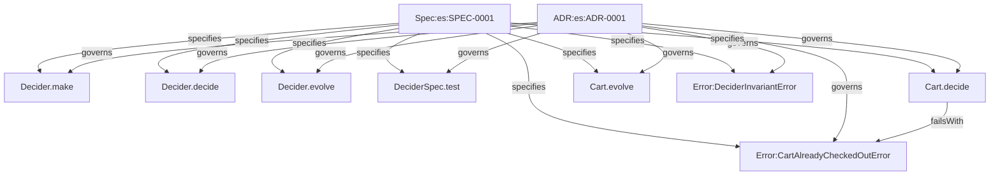

# es:SPEC-0001: Decider Core and BDD Testing Harness

## Context

The `effect-es` framework provides pure event sourcing and CQRS primitives for Effect v4. In event-sourced architectures, the core state transition and command evaluation logic must remain strictly decoupled from infrastructure (storage, networks, and messaging). The Decider pattern models this separation through two pure functions:
- `decide(command, state) -> Effect<ReadonlyArray<Event>, Error, never>`: evaluates intent against current state, emitting zero or more events or returning a domain error.
- `evolve(state, event) -> State`: a total, infallible function that folds an event into a new state.

Existing Graph Context & Boundaries:
- **Reused Contracts / Schemas:** `effect/Schema` for tagged discriminated unions (`Schema.TaggedStruct`, `Schema.TaggedUnion`, `Schema.TaggedClass`).
- **Reused Services:** None. In accordance with the purity gate (`impure-decider`), all decider operations enforce `R = never`.
- **New Capabilities Needed:** Generic `Decider` interface and constructor (`Decider.make`), event envelope abstractions, stream folding helpers (`Decider.evolve`), fluent BDD testing harness (`DeciderSpec`), and property testing invariants.

## Goal

Provide a zero-overhead, purely functional event-sourcing decider engine in Effect v4 with fluent BDD test specifications (`DeciderSpec`) and property-based test verifications, allowing business domains to be fully tested with zero infrastructure.

## How to read the requirements

Requirements follow EARS syntax (Easy Approach to Requirements Syntax). Each requirement is a single normative sentence with bold keywords (**When**, **While**, **If ... then**, **Where**) and the modal **shall** or **shall not**.

## Requirements

### 1 · Decider Engine Contract & Purity

**Source (`docs/mvp_event_sourcing.md` §Core concepts & §Write path):** Deciders hold pure business rules where `R = never` and an empty array of emitted events represents an idempotent no-op.

| ID | Pattern | Requirement | Effect Symbol | Verification |
|---|---|---|---|---|
| REQ-1.1 | Ubiquitous | The Decider.make constructor **shall** return a typed Decider instance encapsulating initialState, evolve, and decide. | Decider.make | UnitTest |
| REQ-1.2 | Ubiquitous | The Decider.decide function **shall** require no environment capabilities (R = never). | Decider.decide | UnitTest |
| REQ-1.3 | Event-driven | **When** a valid command is evaluated against state, The Decider.decide function **shall** return a ReadonlyArray of new events. | Decider.decide | UnitTest |
| REQ-1.4 | State-driven | **While** a command requires no state change, The Decider.decide function **shall** return an empty array of events to signify an idempotent no-op. | Decider.decide | UnitTest |
| REQ-1.5 | Unwanted behaviour | **If** a command violates business invariants, **then** The Cart.decide decider **shall** fail with CartAlreadyCheckedOutError in the E channel. | CartAlreadyCheckedOutError | UnitTest |
| REQ-1.6 | Ubiquitous | The Decider.evolve function **shall** fold a sequence of events deterministically and infallibly into a state with R = never and E = never. | Decider.evolve | PropertyTest |

### 2 · Fluent BDD Testing Harness (DeciderSpec)

**Source (`docs/mvp_event_sourcing.md` §Inspiration from Emmett & §Testing):** Emmett-inspired BDD specification asserting given events, when command, then events / thenNothing / thenFails without infrastructure.

| ID | Pattern | Requirement | Effect Symbol | Verification |
|---|---|---|---|---|
| REQ-2.1 | Event-driven | **When** given a history of prior events and a command, The DeciderSpec.test runner **shall** evolve initialState through the given events, execute decide, and assert expected events. | DeciderSpec.test | UnitTest |
| REQ-2.2 | Event-driven | **When** a command produces no state transitions, The DeciderSpec.test runner **shall** verify that exactly zero events were emitted via thenNothing. | DeciderSpec.test | UnitTest |
| REQ-2.3 | Unwanted behaviour | **If** a command is rejected by domain rules, **then** The DeciderSpec.test runner **shall** verify the exact typed rejection via thenFails. | DeciderSpec.test | UnitTest |

### 3 · Sample Cart Fixture & Property Invariants

**Source (`docs/mvp_event_sourcing.md` §Phase 1 & AGENTS.md Framework Archetype):** Sample domain models live strictly in `test/fixtures` to verify framework behavior and mathematical invariants.

| ID | Pattern | Requirement | Effect Symbol | Verification |
|---|---|---|---|---|
| REQ-3.1 | Event-driven | **When** an item is added to a cart, The Cart.decide decider **shall** emit an ItemAdded event with SKU and quantity. | Cart.decide | UnitTest |
| REQ-3.2 | State-driven | **While** a cart is already checked out, The Cart.decide decider **shall** reject subsequent commands with CartAlreadyCheckedOutError. | CartAlreadyCheckedOutError | UnitTest |
| REQ-3.3 | Ubiquitous | The Cart.evolve reducer **shall** compute identical cart state whether events are folded incrementally or replayed in a single batch. | Cart.evolve | PropertyTest |

## Assumptions

* **REQ-1.4:** Returning an empty event array (`[]`) is the standard representation of an idempotent command execution.
* Events and commands are modeled using Effect `Schema` discriminated unions with a literal `_tag` property.

## Out of scope

* Storage and persistence (Cloudflare Durable Objects, SQLite, D1) — deferred to Phase 2 and Phase 3.
* Outbox queues, alarms, and cross-aggregate projections — deferred to Phase 3.
* HTTP and RPC transport layers — deferred to Phase 4.

## Known residual risks

* Long event streams may accumulate memory during replay if snapshots are not used; snapshots will be addressed post-MVP.

## Acceptance criteria

* All 12 requirement rows pass automated test verification (`UnitTest` and `PropertyTest`).
* Graph policy `impure-decider` and `impure-reducer` pass with zero violations across all decider and reducer functions.
* Sample `Cart` aggregate is verified using `DeciderSpec` with zero infrastructure dependencies.

## Verified Plan Topology Graph

## Pre-Implementation Adversarial Plan Lens Summary

- [x] **Purity Invariant (`R = never`):** Decider and evolve functions require zero services in `R`. Validated by `impure-decider` and `impure-reducer` checks.
- [x] **Idempotency Strategy:** Returning empty event array (`[]`) signifies a no-op command.
- [x] **Error Channel Typing (`E`):** Domain errors are closed discriminated unions extending `Schema.TaggedError`, preserved in `E` channel.
- [x] **Framework Boundary Separation:** Core package `@effect-es/core` contains only generic protocols; `Cart` aggregate lives in `test/fixtures/cart.ts` under `scope:fixture`.

