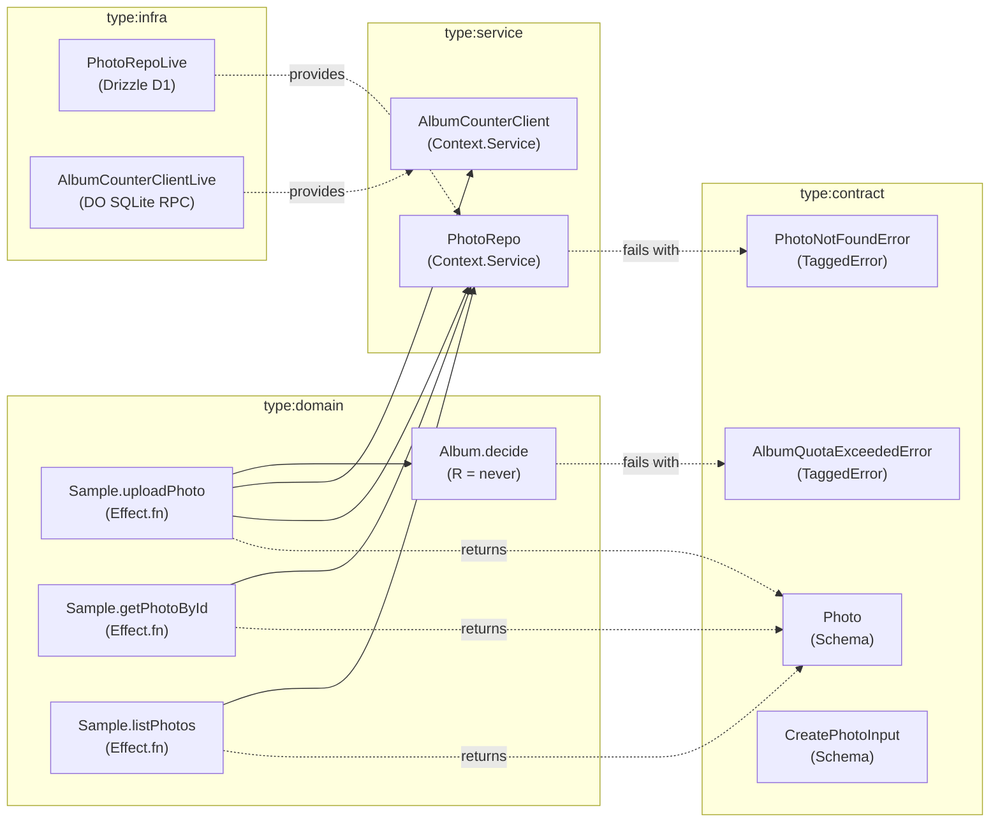

# sample:SPEC-0001: Sample Photo Gallery and Durable Object Album Quota Counter

## 1. Existing Graph Context & Boundaries

- **Reused Contracts / Schemas:**
  - `Photo` (`libs/sample/contract/src/index.ts`): `{ id: number, name: string, albumId: string, createdAt: number }`
  - `CreatePhotoInput` (`libs/sample/contract/src/index.ts`): `{ name: string, albumId: string }`
- **Reused Services:**
  - `PhotoRepo` (`libs/sample/service/src/index.ts`): D1 repository for CRUD read projections (`findById`, `listAll`, `insert`).
  - `AlbumCounterClient` (`libs/sample/service/src/index.ts`): Durable Object RPC client for atomic album quota counters (`getCount`, `increment`).
- **New Capabilities / Errors:**
  - `PhotoNotFoundError` (`libs/sample/contract/src/index.ts`): Tagged error with `{ id: number }`.
  - `AlbumQuotaExceededError` (`libs/sample/contract/src/index.ts`): Tagged error with `{ albumId: string, count: number }`.
  - `Album.decide` (`libs/sample/domain/src/index.ts`): Pure decider with `R = never` enforcing album quota threshold (max 100 photos per album).

---

## 2. EARS Requirements

### UBIQUITOUS (Core Domain Invariants)
- **UBIQUITOUS-1:** THE SYSTEM SHALL ensure all photo identifiers are positive finite integers and timestamps are Unix epoch timestamps in milliseconds.
- **UBIQUITOUS-2:** THE SYSTEM SHALL strictly prohibit any album from containing more than 100 active photos.

### EVENT-DRIVEN (Happy Path)
- **WHEN-1:** WHEN a user submits a valid `CreatePhotoInput` payload via `Sample.uploadPhoto`, THE SYSTEM SHALL query the current album count via `AlbumCounterClient.getCount`, validate quota via `Album.decide`, increment the counter atomically via `AlbumCounterClient.increment`, persist the photo in D1 via `PhotoRepo.insert`, and return the persisted `Photo` object.
- **WHEN-2:** WHEN a user requests a photo by ID via `Sample.getPhotoById`, THE SYSTEM SHALL query `PhotoRepo.findById` and return the matching `Photo` record.
- **WHEN-3:** WHEN a user requests all photos via `Sample.listPhotos`, THE SYSTEM SHALL query `PhotoRepo.listAll` and return a list of all `Photo` records.

### UNWANTED (Typed Failure Conditions in E Channel)
- **IF-THEN-1:** IF a user requests a photo by ID via `Sample.getPhotoById` and no matching record exists in the repository, THEN THE SYSTEM SHALL fail with typed error `PhotoNotFoundError` containing `{ id }`.
- **IF-THEN-2:** IF an upload is attempted via `Sample.uploadPhoto` and the target album already contains 100 or more photos, THEN THE SYSTEM SHALL fail with typed error `AlbumQuotaExceededError` containing `{ albumId, count }` without incrementing the counter or inserting a database row.

### STATE-DRIVEN (Pure Invariants via *.decide)
- **WHILE-1:** WHILE an album's `currentCount >= 100`, THE SYSTEM SHALL reject uploads in pure `Album.decide` (`R = never`) by returning `AlbumQuotaExceededError`.
- **WHILE-2:** WHILE an album's `currentCount < 100`, THE SYSTEM SHALL approve uploads in pure `Album.decide` (`R = never`) and return the next count (`currentCount + 1`).

### OPTIONAL (Config & Feature Flags via R)
- **WHERE-1:** WHERE Cloudflare D1 and Durable Object bindings are configured in `apps/sample`, THE SYSTEM SHALL provide live persistence via `PhotoRepoLive` and `AlbumCounterClientLive` in `type:infra`.
- **WHERE-2:** WHERE executing under test environments (`vitest`), THE SYSTEM SHALL provide in-memory test layers with zero external cloud dependencies.

---

## 3. Affected Nx Packages

1. **`libs/sample/contract` (`type:contract`):** Defines `Photo`, `CreatePhotoInput`, `PhotoNotFoundError`, `AlbumQuotaExceededError`, and `PhotosApiGroup`.
2. **`libs/sample/service` (`type:service`):** Declares service interfaces `PhotoRepo` and `AlbumCounterClient`.
3. **`libs/sample/domain` (`type:domain`):** Implements pure decider `Album.decide` and use-cases `Sample.uploadPhoto`, `Sample.getPhotoById`, `Sample.listPhotos`.
4. **`libs/sample/infra` (`type:infra`):** Implements Drizzle D1 repository `PhotoRepoLive`, Durable Object RPC handler with W3C `traceparent` propagation, and Alchemy resource bindings.
5. **`apps/sample` (`type:app`):** Composes live layers and entrypoints for Cloudflare Worker & DO runtime.

---

## 4. Verified Plan Topology Graph (from harness plan-check)

The following topology graph was generated deterministically by `harness plan-check` and validated against `checkEffectGraph` policies (`domain-requires-infra`, `impure-decider`, `layer-cycle`):

### Pre-Implementation Adversarial Plan Lens Summary
- [x] **Idempotency Keys:** Upload operations accept unique entity parameters; quota validation verifies state before mutation.
- [x] **Partial-Failure Compensation:** In `Sample.uploadPhoto`, quota decision runs first; counter increment and repo insert order is defined; errors short-circuit via Effect typed error channel.
- [x] **Optimistic Concurrency & Races:** High-contention counter updates are isolated in single-writer Durable Object with synchronous SQLite transactions (see sample:ADR-0001).
- [x] **Decider Purity:** `Album.decide` has `R = never`, verified by `GraphPolicyViolation` gate (`impure-decider`).
