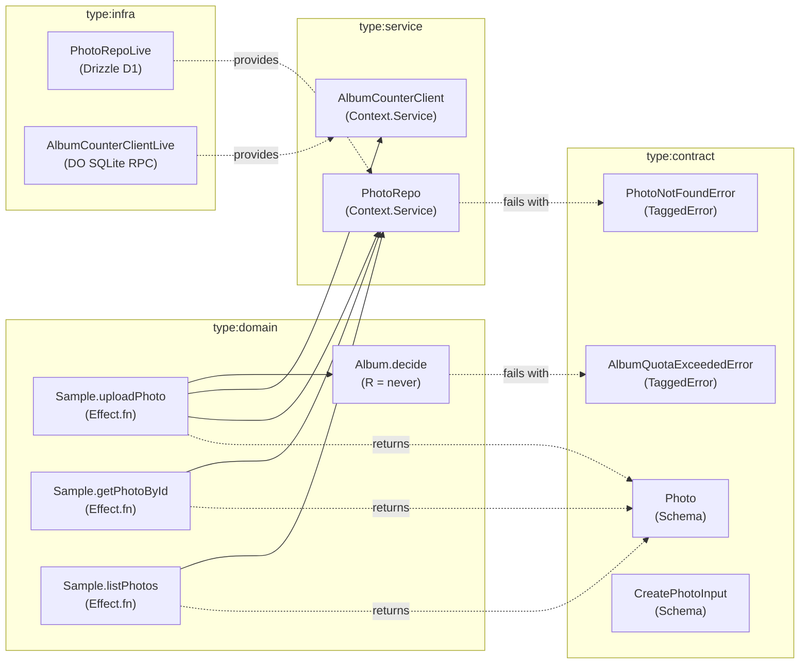

# sample:SPEC-0001: Sample Photo Gallery and Durable Object Album Quota Counter

## Context

Existing Graph Context & Boundaries:
- **Reused Contracts / Schemas:**
  - `Photo` (`libs/sample/contract/src/index.ts`): `{ id: number, name: string, albumId: string, createdAt: number }`
  - `CreatePhotoInput` (`libs/sample/contract/src/index.ts`): `{ name: string, albumId: string }`
- **Reused Services:**
  - `PhotoRepo` (`libs/sample/service/src/index.ts`): D1 repository for CRUD read projections (`findById`, `listAll`, `insert`).
  - `AlbumCounterClient` (`libs/sample/service/src/index.ts`): Durable Object RPC client for atomic album quota counters (`getCount`, `increment`).
- **Capabilities & Errors:**
  - `PhotoNotFoundError` (`libs/sample/contract/src/index.ts`): Tagged error with `{ id: number }`.
  - `AlbumQuotaExceededError` (`libs/sample/contract/src/index.ts`): Tagged error with `{ albumId: string, count: number }`.
  - `Album.decide` (`libs/sample/domain/src/index.ts`): Pure decider with `R = never` enforcing album quota threshold (max 100 photos per album).

## Goal

Provide a robust photo gallery service backed by Cloudflare D1 and Durable Object atomic counters, strictly enforcing album quotas while isolating pure domain decisions from infrastructure.

## How to read the requirements

Requirements are specified using EARS (Easy Approach to Requirements Syntax). Every requirement has a stable identifier (`REQ-<area>.<item>`), a classified EARS pattern, a normative statement using 'shall', a mapped Effect symbol, and an explicit verification method.

## Requirements

### 1 · Photo Gallery CRUD & Schema Contracts
**Source (Core domain & API contract):** Defined in `libs/sample/contract/src/index.ts` and `libs/sample/service/src/index.ts`.

| ID | Pattern | Requirement | Effect Symbol | Verification |
|---|---|---|---|---|
| REQ-1.1 | Ubiquitous | The Photo contract schema **shall** ensure all photo identifiers are positive finite integers and timestamps are Unix epoch milliseconds. | Photo | test |
| REQ-1.2 | Event-driven | **When** a user requests a photo by ID via Sample.getPhotoById, The Sample.getPhotoById use-case **shall** query PhotoRepo.findById and return the matching Photo record. | Sample.getPhotoById | test |
| REQ-1.3 | Event-driven | **When** a user requests all photos via Sample.listPhotos, The Sample.listPhotos use-case **shall** query PhotoRepo.listAll and return a list of all Photo records. | Sample.listPhotos | test |
| REQ-1.4 | Unwanted behaviour | **If** a user requests a photo by ID via Sample.getPhotoById and no matching record exists in PhotoRepo, **then** The Sample.getPhotoById use-case **shall** fail with typed error PhotoNotFoundError containing the requested ID. | PhotoNotFoundError | test |
| REQ-1.5 | Event-driven | **When** a user requests a greeting via Sample.greet, The Sample.greet use-case **shall** format and return a greeting string. | Sample.greet | test |

### 2 · Album Quota Decider & Durable Object Counter
**Source (Durable Object quota invariant, sample:ADR-0001):** Defined in `sample:ADR-0001` and implemented in `libs/sample/domain/src/index.ts`.

| ID | Pattern | Requirement | Effect Symbol | Verification |
|---|---|---|---|---|
| REQ-2.1 | State-driven | **While** an album currentCount is greater than or equal to 100, The Album.decide decider **shall** reject uploads by returning AlbumQuotaExceededError. | Album.decide | propertytest |
| REQ-2.2 | State-driven | **While** an album currentCount is less than 100, The Album.decide decider **shall** approve uploads and return the incremented count. | Album.decide | propertytest |
| REQ-2.3 | Event-driven | **When** a user submits a valid CreatePhotoInput payload, The Sample.uploadPhoto use-case **shall** validate quota via Album.decide, increment counter atomically via AlbumCounterClient, and persist the record via PhotoRepo. | Sample.uploadPhoto | test |
| REQ-2.4 | Unwanted behaviour | **If** an upload is attempted when the album count is at or above 100, **then** The Sample.uploadPhoto use-case **shall** fail with AlbumQuotaExceededError without inserting a database row. | AlbumQuotaExceededError | test |
| REQ-2.5 | Optional feature | **Where** Cloudflare D1 and Durable Object bindings are configured, The @harness/sample-infra layer **shall** provide live persistence via PhotoRepoLive and AlbumCounterClientLive. | PhotoRepoLive | test |
| REQ-2.6 | Optional feature | **Where** executing under test environments, The @harness/sample-infra layer **shall** provide in-memory test layers with zero external cloud dependencies. | PhotoRepoTest | test |

## Assumptions

* **REQ-2.1:** Maximum album quota defaults to 100 photos per album across all tenants unless overridden by administrative policy.
* Photo identifiers are generated sequentially within SQLite primary key sequences.

## Out of scope

* User authentication and identity provider integration (handled by gateway layer).
* Direct binary image storage in R2 (only metadata is managed here).

## Known residual risks

* High concurrency across different albums is fully parallelized, but bursts within a single album are serialized by the Durable Object coordinator.

## Acceptance criteria

* All 11 requirements pass automated test verification (`test` and `propertytest`).
* The graph policies `domain-requires-infra`, `impure-decider`, and `layer-cycle` pass with zero violations.

## Verified Plan Topology Graph

### Pre-Implementation Adversarial Plan Lens Summary
- [x] **Idempotency Keys:** Upload operations accept unique entity parameters; quota validation verifies state before mutation.
- [x] **Partial-Failure Compensation:** In `Sample.uploadPhoto`, quota decision runs first; counter increment and repo insert order is defined; errors short-circuit via Effect typed error channel.
- [x] **Optimistic Concurrency & Races:** High-contention counter updates are isolated in single-writer Durable Object with synchronous SQLite transactions (see sample:ADR-0001).
- [x] **Decider Purity:** `Album.decide` has `R = never`, verified by `GraphPolicyViolation` gate (`impure-decider`).
